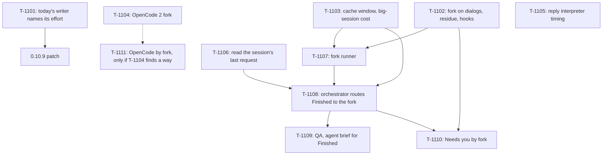

# Kanban: Agent Brief

**Generated:** 2026-11-07
**PRD Version:** 1.1 (`docs/specs/agent-brief/prd.md`)
**Total Tasks:** 11
**Milestones:** M1 Effort fix (ships alone) · M2 Measure the unknowns · M3 Agent brief for Finished · M4 Agent brief for Needs you
**Evidence:** `docs/timeline/2026-11-07_agent-brief-spike.md`; probe scripts and raw results stay local in `.omt/probes/fork-brief/` (git-ignored: the repo is public, and they hold real session text)

## Task Overview

**Critical path:** T-1102 / T-1103 → T-1107 → T-1108 → T-1109. T-1101 is off the path and
ships first.

## Milestone 1: Effort fix (ships alone as a patch)

### T-1101: Today's writer names its effort
- **Type:** feature
- **Status:** done (2026-11-07, branch `agent-brief`; GPT review: no findings). Rerun judged blind: Finished at `low` 4.60 against `xhigh` 4.60, median 6.9 s against 33.2 s; dialogs at `high` 5.00, median 12.0 s. Found: at `low` the version 0.10.8 was misspoken in 3 of 5 briefs (timeline, "After T-1101")
- **Story:** Story 5
- **Description:** The brief writer's `claude -p` names no effort, so it inherits the builder's
  `effortLevel: xhigh` and took 28.7 s on a long turn, 90% of it thinking. An eval of 64
  briefs found no effort more accurate, only slower, except that on dialogs `high` made no
  error where `low` once misdescribed a command. So: a Finished brief runs at `--effort low`,
  a Needs-you brief at `--effort high`.
  In `main/secretary/cli.ts`, `secretaryCliArgs(systemPrompt, effort?)` adds
  `--effort <level>` when one is given, and `runJsonPrompt` takes it in `CliOptions`. In
  `main/secretary/briefWriter.ts`, `writeBrief` passes `low` when `input.event` is
  `"finished"` and `high` when it is `"needs-you"`. The reply interpreter
  (`replyInterpreter.ts`) passes none and keeps today's behaviour until T-1105 says otherwise.
  No `--model` (decisions.md 2026-11-04); `--settings` stays the call's only one
  (tech-conventions, "A one-shot CLI call must not log the builder in").
- **Acceptance:**
  - `cli.test.ts`: the args carry `--effort low` / `--effort high` when given and no
    `--effort` when not; every other flag unchanged.
  - `briefWriter.test.ts`: a Finished input runs with `low`, a Needs-you input with `high`
    (through the `run` fake). `SYSTEM_PROMPT`'s pinned hash unchanged.
  - Re-run the eval on its 8 inputs with the new flags (`.omt/probes/fork-brief/effort/`,
    `run_all.cjs` with the efforts fixed per kind, `judge.cjs`, `report.py`): Finished briefs
    score at least as `xhigh` did (4.70 on the 5 Finished inputs), dialog briefs at least as
    `high` did (5.00). The long-turn sample C1 alone is ready in about 8 s.
  - `pnpm lint`, `pnpm type`, `pnpm test` green.
- **Blocks:** the 0.10.9 patch
- **Blocked by:** none
- **Parallel with:** T-1102, T-1103, T-1104, T-1105, T-1106
- **Notes:** The release (version bump, READMEs, DMG) follows CLAUDE.md's release process and
  needs the builder's go-ahead and patch/minor choice.

## Milestone 2: Measure the unknowns (no app code)

### T-1102: Fork on dialogs, residue and the builder's hooks
- **Type:** qa
- **Status:** ready
- **Story:** Stories 2 and 4 (G-901, G-907, G-908)
- **Description:** Three questions about forks that the 2026-11-07 spike didn't answer, each
  measured on the real CLI with the spike's command (timeline, "The command that works").
  1. **G-901, dialogs.** Start real Claude sessions in a temp project that stop on a
     permission dialog, an AskUserQuestion and an ExitPlanMode (to get permission dialogs at
     all, run with `--setting-sources project,local`: the builder's user settings allow Bash,
     Write and Edit, so no permission dialog appears otherwise). While each dialog is
     open, fork the session with a request to explain the dialog. Check: the fork runs; the
     dialog is still open and unchanged; nothing is answered; the brief says why the agent
     needs the step, what the operation does, and the options. Compare with today's writer on
     the same moments using the eval's judge (`.omt/probes/fork-brief/effort/judge.cjs`).
  2. **G-907, residue.** Snapshot `~/.claude` (file list with sizes and mtimes; skip
     `projects/` content of other sessions) before and after five forks. Anything new or
     changed that a fork caused (registry entries, plugin `.in_use` markers, shell
     snapshots, todos, file history) is listed.
  3. **G-908, hooks.** In a fake `HOME` with a copy of the settings shape, add a logging hook
     for every event and run a fork: which of the user's hooks fire, and does any of them
     report the fork as a session somewhere (the builder runs Orca's agent hooks).
- **Acceptance:** a timeline entry `docs/timeline/YYYY-MM-DD_agent-brief-fork-checks.md` with
  each answer, the commands, and what Story 2 and Story 4 must change, if anything. G-901,
  G-907, G-908 closed in `gaps.md`. No company names, real paths or session text in `docs/`.
- **Blocks:** T-1107, T-1110
- **Blocked by:** none
- **Parallel with:** T-1101, T-1103, T-1104, T-1105, T-1106
- **Notes:** Never fork the builder's own live sessions with tools that can run; the blocking
  hook must be in the one `--settings`. Spend is reported in the entry.

### T-1103: Cache window and big-session cost
- **Type:** qa
- **Status:** ready
- **Story:** Story 3, NFR Cost and Performance (G-903, G-904)
- **Description:** A fork reads the session's cache only while the provider keeps it (5
  minutes, `ephemeral_5m`, as measured). Two numbers decide when Multi-Code forks:
  1. **G-904.** How long after a request does an identical-prefix request still read it? On a
     copy of a session of about 100k tokens in a temp project, run the same fork request
     twice, with 1, 3, 4, 5 and 6 minutes between the pair (a new copy or a new request text
     for each pair, so pairs don't warm each other). The second of each pair shows whether the
     cache was still there (`cache_read_input_tokens` against
     `cache_creation_input_tokens`). Also check whether Claude Code ever writes the 1-hour
     cache (`ephemeral_1h_input_tokens`) for the builder's setup.
  2. **G-903.** On a copy of a 400k+ session, the same pair one minute apart: the second run's
     cost and time are the warm cost of a big session.
  Cost of a run is the envelope's `total_cost_usd` minus the copied session's last
  `cost-state.totalCostUSD`.
- **Acceptance:** a timeline entry with the table, the threshold Story 3 should use (the PRD
  assumes 4 minutes), and the warm cost and time at 400k+. G-903 and G-904 closed. Copies
  under `~/.claude/projects/` removed afterwards.
- **Blocks:** T-1107, T-1108
- **Blocked by:** none
- **Parallel with:** T-1101, T-1102, T-1104, T-1105, T-1106
- **Notes:** The first run of each pair is a cold read (about $0.5 at 100k, $2 at 435k on
  2026-11-07). Keep the pairs few.

### T-1104: OpenCode 2 fork
- **Type:** qa
- **Status:** ready
- **Story:** Story 3, Out of Scope (G-902)
- **Description:** Find out whether an OpenCode 2 session can be forked for one answer with
  nothing saved: no session in the builder's OpenCode database, nothing in the shared service
  (CLAUDE.md "OpenCode 2 only": Multi-Code puts nothing into that service). Read OpenCode
  2's session and fork API (its HTTP API; the 2026-11-04 `opencode run` spike,
  `docs/timeline/2026-11-04_secretary-opencode-run-spike.md`, shows how residue was measured) and measure
  in a fake `HOME` the same way.
- **Acceptance:** a timeline entry with the answer and, if there is a way, its command and its
  residue. G-902 closed. If there is no way, OpenCode briefs stay with today's writer and
  T-1111 is cancelled.
- **Blocks:** T-1111
- **Blocked by:** none
- **Parallel with:** every other M2 task
- **Notes:** The builder's own service and database are never touched.

### T-1105: Reply interpreter timing
- **Type:** qa
- **Status:** ready
- **Story:** G-909 (voice-secretary Story 6)
- **Description:** The reply interpreter (`main/secretary/replyInterpreter.ts`) reads a spoken
  reply to a dialog with the same `claude -p` flags as the brief writer, so it also inherits
  `xhigh`. Time it on real replies (its live test `replyInterpreter.live.test.ts` shows the
  input shape) at the default and at `low`, `medium`, `high`. If the default is slow, judge
  accuracy the way the brief eval did: the right choice, the right ask-back, never a wrong
  key.
- **Acceptance:** a timeline entry with times and, if needed, an accuracy table; a
  recommendation for the builder. G-909 closed or turned into a task.
- **Blocks:** none
- **Blocked by:** none (uses T-1101's `effort` option if done first)
- **Parallel with:** every other M2 task
- **Notes:** A wrong reading presses a wrong key, so accuracy rules here even more than for
  briefs.

## Milestone 3: Agent brief for Finished

After M3, a Claude session's Finished brief comes from the agent itself, in the first person,
in about 15 s, and today's writer covers everything else.

### T-1106: Read the session's last request
- **Type:** data
- **Status:** ready
- **Story:** Story 1, Story 3
- **Description:** A fork must start with the same model and effort as the session's last
  request, or it loses the cache. The session's JSONL records every request as an
  `api-request` row whose `params` hold `"model"` and `"output_config": {"effort": ...}`,
  with a `timestamp`. Add `readClaudeLastRequest(jsonlPath)` next to the transcript readers
  (`main/backends/claudeTranscript.ts`), returning `{ model, effort, at }` from the last
  `api-request` row, or `null` when there is none or it doesn't parse. Read from the end of
  the file, as the other readers do for large files. Also give
  `processManager.secretarySource()` the instance's `cwd`, which the fork runs in.
- **Acceptance:** unit tests on fixture JSONL: the last row wins; a missing effort or model
  gives `null`; a file with no `api-request` rows gives `null`; a 10 MB file is read without
  loading it whole. Tests never read the real HOME (tech-conventions). Full suite green.
- **Blocks:** T-1108
- **Blocked by:** none
- **Parallel with:** T-1101 and all of M2

### T-1107: Fork runner
- **Type:** feature
- **Status:** backlog
- **Story:** Story 1, Story 4
- **Description:** A new `main/secretary/fork.ts` runs one fork and returns a `Brief`, never
  throwing: `claude -p --resume <sessionId> --fork-session --no-session-persistence
  --output-format json --model <model> --effort <effort> --settings <json>`, in the session's
  `cwd`, the request on stdin. The one `--settings` holds `awsAuthRefresh: "false"` and a
  PreToolUse hook on every tool that exits 2 with a short message, plus whatever T-1102
  requires. Same binary and env as an instance (`claudeCliCommand()`), same abort, timeout
  and SIGTERM-then-SIGKILL handling as `runJsonPrompt` (share the spawn code in `cli.ts`
  rather than copy it). The request (`FORK_PROMPT`) asks for what the agent did since the
  builder's last message, what matters most, in the first person, 30 to 45 seconds, with
  today's rules for the ear and the language rule, "answer at once", no tools, and the same
  `{"language", "brief"}` JSON, parsed by `parseBrief`. Its hash is pinned in a test, as
  `SYSTEM_PROMPT`'s is. Spike prompts to start from: `.omt/probes/fork-brief/prompt-short-quick.txt`.
- **Acceptance:** unit tests with a fake spawn: the exact args, the cwd, stdin not argv, one
  `--settings` with the hook, abort kills it, a timeout gives a reason, a bad answer gives a
  reason. A live test (skipped by default, like `briefWriter.live.test.ts`) forks a temp
  session and gets a brief. Full suite green.
- **Blocks:** T-1108
- **Blocked by:** T-1102, T-1103
- **Parallel with:** T-1106

### T-1108: The orchestrator sends Finished briefs to the fork
- **Type:** integration
- **Status:** backlog
- **Story:** Story 1, Story 3
- **Description:** In `main/secretary/briefWriter.ts` `writeBriefFor` (called by
  `secretary/index.ts` `run`), a Finished event of a Claude session goes to the fork when the
  session's record gives a model and an effort and its last request is younger than the
  threshold from T-1103 (the PRD assumes 4 minutes). Everything else goes to today's writer:
  OpenCode, no record, an old last request, Needs you (until T-1110). A fork that fails, or
  gives nothing within 30 s, falls back to today's writer once, inside the same job, so the
  event still gets one brief and the abort of a newer event or of Secretary Mode stops
  whichever is running. Nothing else in the orchestrator, the bar, the push or the phone
  link changes.
- **Acceptance:** unit tests with fakes for the record, the fork and today's writer: each
  routing rule; the fallback on failure and on the 30 s limit; abort during the fork and
  during the fallback; one published brief per event. Full suite green.
- **Blocks:** T-1109, T-1110
- **Blocked by:** T-1103, T-1106, T-1107

### T-1109: QA, agent brief for Finished
- **Type:** qa
- **Status:** backlog
- **Story:** Stories 1, 3, 4
- **Description:** Check M3 in the real app and against the eval.
  1. The real app with its own `--user-data-dir` (never the installed app's userData: the
     two share one folder, and a dev build quitting removes the installed app's spawn files), driven over CDP (tech-conventions,
     "Verifying UI changes without a human"), Secretary Mode on, a real Claude session in a
     temp project doing a short task: the bar shows a first-person brief within 15 s of the
     Finished; the project's files, `git status`, the project's session files and `~/.claude`
     are as before (T-1102's list); no extra Finished or Needs you appears for the fork.
  2. Fallback: an event older than the threshold, an OpenCode session, and a fork made to
     fail each get today's writer's brief.
  3. Quality: agent briefs on the eval's Finished samples, judged blind with today's writer at
     `xhigh`, score at least as high; on the long release sample the brief names both tasks.
- **Acceptance:** a QA note in the timeline with the results; any bug becomes a task here.
- **Blocks:** none
- **Blocked by:** T-1108

## Milestone 4: Agent brief for Needs you (and OpenCode, if possible)

### T-1110: Needs-you briefs by fork
- **Type:** feature
- **Status:** backlog
- **Story:** Story 2
- **Description:** Only if T-1102 found that a fork briefs an open dialog well and leaves it
  untouched. A Needs-you event of a Claude session goes to the fork under T-1108's rules,
  with a request (`FORK_DIALOG_PROMPT`, hash pinned) asking why the agent needs this step,
  what the operation will actually do (and says so when it deletes, overwrites, pushes,
  installs or reaches outside the project), and the question with its options and its
  recommendation. Replies in words still go through the dialog code as today
  (`secretary/dialog.ts`). If T-1102 found it doesn't work, mark this task cancelled and
  Story 2 dropped.
- **Acceptance:** unit tests for the routing and the request; T-1102's dialog cases rerun in
  the real app: the brief arrives, the dialog is still open, a reply in words still answers
  it. Judged blind against today's writer at `high` on the eval's dialog samples: at least
  as accurate.
- **Blocks:** none
- **Blocked by:** T-1102, T-1108

### T-1111: OpenCode briefs by fork
- **Type:** feature
- **Status:** backlog
- **Story:** Story 3 (Out of Scope unless G-902 finds a way)
- **Description:** Only if T-1104 found a fork of an OpenCode 2 session that saves nothing.
  Then OpenCode Finished briefs take the fork path as Claude's do, with T-1104's command.
  Otherwise cancelled.
- **Acceptance:** to be written from T-1104's result.
- **Blocks:** none
- **Blocked by:** T-1104, T-1108

## Legend

- **Blocks:** This task must complete before the listed tasks can start
- **Blocked by:** This task cannot start until the listed tasks complete
- **Parallel with:** These tasks have no dependency and can be worked simultaneously

## Changelog

- 2026-11-07: Generated from PRD v1.1. T-1101 first, shippable alone; M2 measures G-901 to
  G-904 and G-907 to G-909 before the fork code. Builder at review: the breakdown stands;
  tasks one at a time, not in parallel; T-1101 is shown to the builder before any release.
- 2026-11-07: T-1101 done. Its rerun found `low` misspeaking multi-part versions.
