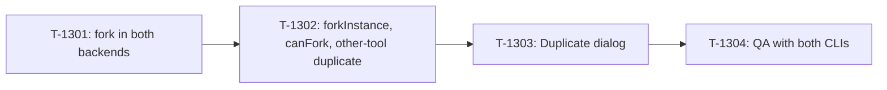

# Kanban: Duplicate Options

PRD: `docs/specs/duplicate-options/prd.md` (v1.0). One lane: the tasks share
`process-manager.ts`, `ContactList.tsx` and `App.tsx`.

### T-1301: Fork in both backends
- **Story:** 2
- **Description:** A `fork` session start for Claude Code (`--resume <src> --fork-session
  --session-id <new>`), and `forkSession` on both backends: Claude checks there is a
  transcript; OpenCode calls the shared service's `POST /api/session/{id}/fork` and starts
  the copy as the contact's own. Recorded as the second API exception (decisions.md,
  CLAUDE.md).
- **Status:** done (2026-11-20, branch `session-notes`, not committed)

### T-1302: forkInstance, canFork, other-tool duplicate
- **Story:** 2, 3, 4
- **Description:** `ProcessManager.forkInstance` (the contact's own session only, never the
  directory's latest; no contact when the fork fails or the source goes meanwhile),
  `canFork`, and `duplicateInstance` with a backend. IPC `fork-instance`, `can-fork`,
  `duplicate-instance` with a backend; fork failures traced.
- **Blocked by:** T-1301
- **Status:** done

### T-1303: Duplicate dialog
- **Story:** 1 to 4
- **Description:** Replaces the Duplicate confirmation: Fork, New session, New session with
  the other tool, Cancel, each with its line; disabled with the reason when it can't run;
  Fork focused once main says it can; Tab and Esc kept inside; held keys swallowed after.
- **Blocked by:** T-1302
- **Status:** done

### T-1304: QA with both CLIs
- **Story:** all
- **Description:** In an isolated dev build with fake contacts: a Claude fork remembered
  the source's word and left the source's transcript unchanged (39 lines before and after);
  an OpenCode fork through the service did the same; New session with OpenCode made an
  OpenCode contact. Test sessions removed afterwards.
- **Blocked by:** T-1303
- **Status:** done
