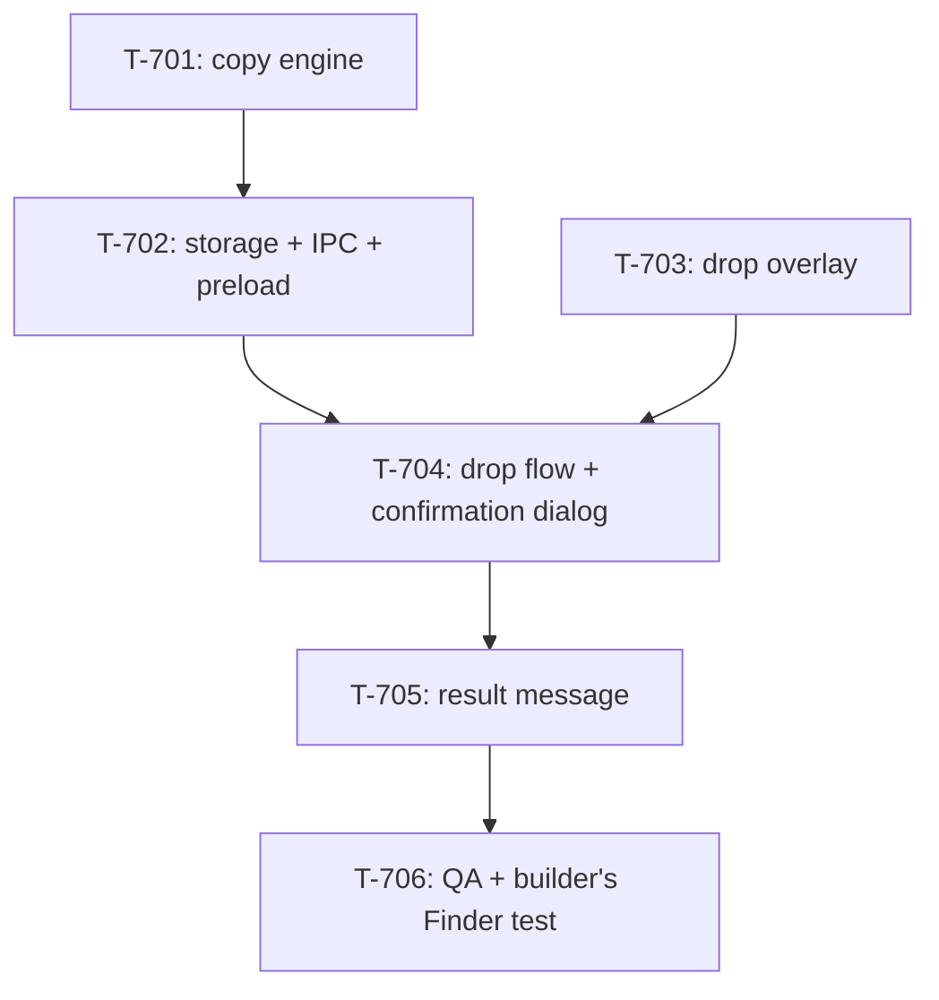

# Kanban: File Drop

**Generated:** 2026-10-28
**Source:** `docs/specs/file-drop/prd.md` v1.1 · `docs/specs/file-drop/gaps.md`
**Total Tasks:** 6 (T-701..T-706)
**Milestones:** M1 (drop files into a project) · M2 (QA and the builder's Finder test)

Task ids start at T-701 so they never collide with earlier epics (the highest is T-611).

## Task Overview

**Critical path:** T-701 → T-702 → T-704 → T-705 → T-706. The copy engine is first
because the IPC wraps it, and the dialog's outcome is a call to that IPC.

**Parallelizable:** T-703 (renderer, overlay only) shares no file with T-701 or T-702.
It can run beside them.

**Only looks parallel:** T-704 and T-705 both render from `App.tsx` and share the drop
state. Do them in order.

---

## Milestone 1: Drop files into a project

**Goal:** a Finder drop anywhere on the window lands in the selected project's folder, as
PRD Stories 1 to 5 describe.

**Tasks:** T-701, T-702, T-703, T-704, T-705

**Done when:**
- Dragging files over the window shows the overlay with the target project; Manager or no selection is refused; a text or link drag shows nothing; contact reordering is unchanged
- The first drop in a project opens the picker with the "No default folder" text; the folder picked is saved and the files are copied there
- Later drops show the dialog; Put here / Somewhere else… / Change default path… / Esc each do what Story 3 says
- Copies never overwrite (`report 2.docx`), folders copy whole, a folder into itself is refused
- The message lists each new path relative to the project, renamed copies and failures included
- Default folders survive a restart, and are per project directory

## Milestone 2: QA and the builder's Finder test

**Goal:** every acceptance criterion checked, and G-211 closed by a real Finder drag.

**Tasks:** T-706

**Done when:** `pnpm test`, `pnpm lint`, `pnpm type` pass; the CDP checks pass on an
isolated dev build; the builder has dragged a file and a folder from Finder and the log
shows their real paths.

---

### T-701: Copy engine with Finder-style names

- **Type:** feature
- **Status:** done
- **Story:** 4
- **Description:** New main-process module `workspace/app/src/main/file-drop.ts`, with no
  `electron` import so plain vitest can run it. One async function copies a list of
  absolute source paths (files or folders) into a target folder and returns one result
  per source: the source, the destination path, whether it was renamed, or an error.
  - Copy, never move. Files: `fs.promises.copyFile` with `COPYFILE_EXCL`. Folders:
    `fs.promises.cp` with `recursive: true`, `errorOnExist: true`, `force: false`.
  - Name clash: try `name 2.ext`, `name 3.ext`, … as Finder does. The number goes before
    the last extension only. A name with no extension, or a dotfile (`.env`), gets the
    number at the end (`assets 2`, `.env 2`). On `EEXIST` during the copy, try the next
    number, so a file that appears in between is never overwritten.
  - A folder copied into itself or into one of its subfolders is refused (compare
    `realpath`s). The result says so; the other sources still copy.
  - Errors become short, plain reasons: `EACCES`/`EPERM` → "no permission", `ENOSPC` →
    "disk full", `ENOENT` → "no longer exists", anything else → the error's message.
  - Sources that fail do not stop the others. Copies already made stay.
- **Acceptance:** `file-drop.test.ts` in a temp directory covers: a plain copy (original
  still there); a clash giving `report 2.docx`, and `report 3.docx` when 2 exists too; a
  dotfile and a no-extension name; a folder with subfolders copied whole; a folder into
  itself refused while the other sources copy; a missing source reported as "no longer
  exists"; nothing in the target ever overwritten.
- **Blocks:** T-702
- **Blocked by:** none
- **Parallel with:** T-703
- **Notes:** Every file type is accepted; the module never looks at the type. Symlinks
  stay links (the `cp` default), which is what Finder does.

### T-702: Default-folder storage, IPC and preload

- **Type:** integration
- **Status:** done
- **Story:** 2, 3, 5
- **Description:** Wire T-701 and the per-project default folder to the renderer.
  - **Storage:** add `dropFolders: Record<string, string>` (project directory → absolute
    folder) to `Settings` in `main/settings-store.ts`. `loadSettings` keeps only string
    entries; the default is `{}`. Every save merges into the loaded settings, so the
    theme and the secretary fields are not lost (check the handler at
    `ipc-handlers.ts:486` for the existing pattern).
  - **IPC** in `main/ipc-handlers.ts`, bridged in `main/preload.ts`, typed in
    `shared/types.ts`:
    - get a project's default: `{ path, exists }`, or `path: null` when none is set;
    - set a project's default;
    - describe the dropped paths: name and whether each is a folder (for the dialog's
      title and list);
    - pick a folder: `dialog.showOpenDialog` with `openDirectory` and `createDirectory`,
      a `message` (the text Story 2 gives), and a start folder; returns the path or
      `null`;
    - copy: calls T-701 and returns its results, with each destination also given
      relative to the project directory when it is inside it.
  - **Preload:** `getPathForFile(file)` via `webUtils.getPathForFile`. It is synchronous
    and not an IPC. It returns `""` for an item with no file on disk.
  - **Debug trace:** with `MULTICODE_DEBUG=1`, the copy IPC writes the dropped paths and
    the target folder through `debug-trace.ts`. T-706's Finder test reads this.
  - **CLAUDE.md:** the `settings.json` line under Data Storage adds "each project's
    default drop folder".
- **Acceptance:** `settings-store.test.ts` covers `dropFolders` loading (bad entries
  dropped, missing field → `{}`) and saving next to the other fields. `pnpm type` passes
  with the new `electronAPI` methods.
- **Blocks:** T-704
- **Blocked by:** T-701
- **Parallel with:** T-703
- **Notes:** Key by the contact's `cwd` string as stored, so two contacts on one project
  share the folder. Default folders are written only to `userData`, never into a project.

### T-703: Drop overlay over the whole window

- **Type:** feature
- **Status:** done
- **Story:** 1
- **Description:** Window-level drag listeners (a hook in `renderer/hooks/`, used from
  `App.tsx`) and an overlay component in `renderer/components/`.
  - React only when `dataTransfer.types` includes `"Files"`. A text or link drag, and
    the sidebar's contact reordering (which carries `text/plain` only), get no overlay
    and no `preventDefault`, so they behave as today.
  - On `dragover` with files: `preventDefault()` and `dropEffect = "copy"`, so the
    `drop` event fires (probe 2026-10-28: without it, no `drop` arrives).
  - The overlay covers the window. It shows the selected contact's display name and
    project directory. With the Manager (`isManager`) or no contact selected, it says
    files can't be dropped there and why, and the drop does nothing.
  - No overlay, and the drop is ignored, while any Multi-Code dialog is open
    (`.dialog-overlay` is in the DOM, and the diff window counts too).
  - The overlay goes when the drag leaves the window or is cancelled with Esc. Child
    elements fire their own `dragenter`/`dragleave`, so count them, or hide only when
    `relatedTarget` is `null`, to stop it flickering.
  - On a valid drop, hand the `File` objects and the target contact to a callback.
    T-704 supplies it; until then it may log.
  - A pure function decides the overlay state from the selected instance and whether a
    dialog is open, so it can be unit-tested.
- **Acceptance:** unit test for the state function (target, Manager refused, none
  selected refused, dialog open → nothing). By CDP on an isolated dev build
  (`--user-data-dir=/tmp/...`): `Input.dispatchDragEvent` with `files` shows the overlay
  with the right name; a drag with only `text/plain` shows none; the contact list still
  reorders.
- **Blocks:** T-704
- **Blocked by:** none
- **Parallel with:** T-701, T-702
- **Notes:** During a drag the page sees only `types = ["Files"]`, not the paths
  (probe 2026-10-28), so the overlay can't tell a Finder file from a browser image. That
  is reported after the drop (T-704, PRD v1.1).

### T-704: Drop flow and the confirmation dialog

- **Type:** feature
- **Status:** done
- **Story:** 1, 2, 3, 5
- **Description:** What happens between the drop (T-703) and the copy (T-702).
  1. Get each file's path with `getPathForFile`. If any is `""`, copy nothing and report
     "Only files from Finder can be dropped" (through T-705; until then, log).
  2. Get the project's default folder.
  3. **No default:** open the picker at the project directory with "No default folder
     for <project> yet. Choose where dropped files go." The folder picked becomes the
     default; copy there. Cancel → nothing.
  4. **Default gone** (`exists: false`): the same, with "The default folder <path> no
     longer exists. Choose where dropped files go."
  5. **Default set:** open `FileDropDialog.tsx`, built like `RenameSessionDialog.tsx`
     (`.dialog-overlay`, `.dialog`, `.dialog-actions`, `dialog-btn primary`), laid out as
     in PRD Story 3:
     - title "Put 2 files in <project>?" (counts files and folders from the describe IPC);
     - the target folder, relative to the project when inside it, else the full path
       with `~` for home;
     - up to five names, then "+N more";
     - **Put here** (primary, Enter) → copy to the default;
     - **Somewhere else…** → picker starting at the default; copy there; the default
       stays;
     - **Change default path…** → picker starting at the default; save it as the
       default; copy there;
     - Esc or a click outside → close, nothing copied. Cancelling a picker → nothing
       copied, default unchanged.
  6. Hand the copy results to T-705 (until then, log).
- **Acceptance:** pure helpers (title wording, target display, the five-name list) are
  unit-tested. By CDP on an isolated dev build with `dropFolders` seeded in the temp
  `settings.json`: a synthetic drop opens the dialog with the right title and folder;
  Enter copies into the folder; Esc copies nothing; nothing is ever written to the
  session's terminal. The picker paths are checked by hand in T-706, because CDP can't
  drive the native panel.
- **Blocks:** T-705
- **Blocked by:** T-702, T-703
- **Parallel with:** none
- **Notes:** A stopped contact's project accepts drops (confirmed 2026-10-28). The
  dialog must not take focus from the terminal after it closes: return focus to the
  terminal, as the other dialogs do.

### T-705: The message after a drop

- **Type:** feature
- **Status:** done
- **Story:** 1, 4
- **Description:** A small message component in `renderer/components/`, shown by
  `App.tsx` near the bottom of the window. Multi-Code has no toast today, so this is
  new; keep it compact.
  - "Copying…" while the copy runs.
  - Then one line per source: its new path relative to the project
    (`docs/sources/inbox/report.docx`; full path if outside the project). A renamed copy
    shows its new name. A failure shows the name and the reason from T-701. A folder
    refused for copying into itself says so.
  - "Only files from Finder can be dropped" for the case in T-704 step 1.
  - Goes away by itself after a few seconds (longer when something failed). It never
    takes keyboard focus from the terminal.
  - A pure function turns copy results into the lines, so it can be unit-tested.
  - Replace the logging that T-703 and T-704 left in its place: render the
    `dropReport` state in `App.tsx` (`DropReport` in `renderer/components/dropFlow.ts`:
    `copying` / `copied` with outcomes / `only-finder` / `error`), replacing the effect
    that `console.debug`s it.
  - A failed outcome with `partial: true` reads "partly copied" and shows its `display`.
  - "Copying…" only after a short delay, so an instant copy doesn't flash it.
  - Overlapping drops: tag each report with its drop, so one drop's `copied` can't
    replace another's `copying`.
  - **Added 2026-10-28 from T-704:** a deadline on the lookups before the dialog
    (`getDropFolder`, `describeDropped`). The keyboard is held from the drop until the
    dialog or picker has it, so a lookup that never returns (a dead network volume)
    would hold it forever. Past the deadline, abandon the drop, report an error, and
    give the keyboard back (`returnDropKeys`).
- **Acceptance:** unit test for the lines (all copied, one renamed, one failed and the
  rest copied, partly copied, folder into itself, only-Finder). By CDP: after a seeded drop, the
  message shows the relative path, then disappears; typing still reaches the terminal
  while it shows.
- **Blocks:** T-706
- **Blocked by:** T-704
- **Parallel with:** none
- **Notes:** Partial failures keep the copies already made, and the message lists both
  (confirmed 2026-10-28).

### T-706: QA and the builder's Finder test

- **Type:** qa
- **Status:** backlog
- **Story:** all
- **Description:**
  1. Run `pnpm test`, `pnpm lint`, `pnpm type`.
  2. Walk every PRD acceptance criterion that CDP can reach, on an isolated dev build
     (`--user-data-dir=/tmp/...`, never the real `userData`; the release app may be
     running). Record what passed and what needs the builder.
  3. Prepare the builder's test (G-211): an isolated dev build with
     `MULTICODE_DEBUG=1`, one test contact on a scratch project directory, and a short
     list of what to drag. The list covers:
     - one file and one folder from Finder, on the first drop (the picker);
     - Put here, Somewhere else…, Change default path…;
     - the same file again (`name 2`);
     - an image from a browser (the only-Finder message).
     The builder runs it; Claude reads the debug log and the scratch folders.
  4. Close G-211 in `gaps.md` with what the log showed. File any bug as a new task here.
- **Acceptance:** all automated checks pass; the builder's Finder drag shows the real
  paths in the log; every acceptance criterion is marked passed or has a task.
- **Blocks:** none
- **Blocked by:** T-705
- **Parallel with:** none
- **Notes:** The README update belongs to the release, per the release process.

## Legend

- **Blocks:** This task must complete before the listed tasks can start
- **Blocked by:** This task cannot start until the listed tasks complete
- **Parallel with:** These tasks have no dependency and can be worked simultaneously

## Changelog

- 2026-10-28: Generated from PRD v1.1. Breaking the PRD down found that the overlay
  can't tell a Finder file from a browser image (PRD v1.1 changelog).
- 2026-10-28: T-701 done (GPT review, 2 rounds: no deletes, no `fs.cp`, folder-into-itself by device and inode). T-703 done (GPT: no findings; in-page drags ignored). T-702 done (GPT: no findings). Merged into `feat/file-drop`, plus 2da48c2 for a clash between them. T-704 started; it also carries `partial`/`destination` into the copy IPC and brings the window to the front on a drop.
- 2026-10-28: T-704 done (GPT review: two ways a key could reach the terminal around a drop, both fixed in 1a66b0e) and merged (255f73e). T-705 gained four items from T-704's report, including a deadline on the pre-dialog lookups. Builder stopped for the day; next is T-705.
