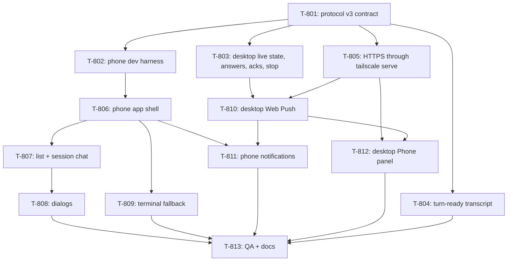

# Kanban: Mobile v2

**Generated:** 2026-10-29
**Source:** `docs/specs/mobile-v2/prd.md` v1.0 · `docs/specs/mobile-v2/gaps.md` ·
`docs/specs/mobile-v2/mockups/index.html`
**Total Tasks:** 13 (T-801..T-813)
**Milestones:** M1 (the phone works over HTTPS) · M2 (push, and the desktop's Phone panel) ·
M3 (QA on the builder's iPhone, docs)

Task ids start at T-801 so they never collide with earlier epics (the highest is T-709).
Branch `feat/mobile-v2`, worktree `../multi-code-mobile-v2`. The 2026-10-13 worktree
(`../multi-code-mobile-app-v2`, uncommitted diff on 0.8.2) is reference only: read its
`git diff` for ideas, never merge it.

## Task Overview

**Critical path:** T-801 → T-802 → T-806 → T-807 → T-808 → T-813. The phone UI is the
longest chain; the harness comes first so every phone ticket can see its own screens
without the desktop lane.

**Parallel after T-801:** T-802, T-803, T-804, T-805. T-803 and T-805 both edit
`main/remote/ws-server.ts`, in different functions (T-803: frame handling and broadcasts;
T-805: `start`, `createPairingOffer`, `getStatus`); merge T-803 first.

**Only looks parallel:** T-807 and T-809 both add a screen to the phone app's router and
styles; T-809 may run beside T-807 only if it keeps to its own component and CSS file.
T-810 edits `ws-server.ts` and `process-manager.ts` after T-803 has.

**Shared rules for every ticket:**
- `workspace/app/src/shared/remote-protocol.ts` is the contract. A ticket that needs a
  change to it stops and asks the supervisor.
- Tests must not read the real HOME (`docs/knowledge/tech-conventions.md`).
- Never quit an isolated test instance with a contact running (a native dialog pops on the
  builder's screen). Test any audio at low volume.
- Never run `tailscale up/down`, `tailscale serve` or `tailscale cert` against the
  builder's real Tailscale, and never start or stop Tailscale: read-only
  `tailscale status --json` and `tailscale serve status --json` only. The builder turns
  things on at QA.
- Phone screens are checked with Playwright WebKit at iPhone size (393 × 852, device
  scale 3, touch) against the harness (T-802), in dark and light. There is no iOS
  Simulator (G-319).

---

## Milestone 1: The phone works over HTTPS

**Goal:** from Safari on the tailnet, the new phone app lists sessions, shows a session as a
chat, sends replies, answers every dialog, stops a turn, and falls back to the terminal
(PRD Stories 1–6, 8, 10 steps 1–2).

**Tasks:** T-801 … T-809

**Done when:**
- `pnpm type`, `pnpm lint`, `pnpm test`, `pnpm build` pass on `feat/mobile-v2`
- Every mockup screen of groups 1A, 2, 3 and 4 is reproduced by the harness and matches
  the mockup in Playwright WebKit (dark and light)
- On an isolated dev build, the phone app answers a real Claude permission dialog, a
  question box with two questions (one multi-select), and a plan, and stops a real turn

### T-801: Protocol v3 contract

- **Type:** setup
- **Status:** done
- **Story:** all
- **Description:** `workspace/app/src/shared/remote-protocol.ts` rewritten as protocol v3:
  `origin` replaces `endpoints` in the pairing offer; `RemoteInstance.state/since/preview`
  replace `activity`; new client frames `answer`, `interrupt`, `push-subscribe`; `prompt`,
  `answer`, `interrupt`, `push-subscribe` carry a `clientMsgId` and get an `ack`;
  `auth-ok` carries `vapidPublicKey`/`pushEnabled`; `snapshot` carries `cols/rows`; new
  `resize`; `transcript` carries `hasEarlier`; `TranscriptEntry` gains optional
  `id/at/outcome/added/removed`; `prompt-state` carries `seq`, `summary` and an optional
  full `RemoteDialog`; `RemoteStatus.checks` replaces `endpoints`; `PairedDevice` gains
  push fields. `choose` and `activity` frames are gone. Every consumer is changed just
  enough to compile, with placeholders marked `// mobile-v2 T-8xx:`. The old phone UI is
  replaced by a placeholder screen.
- **Acceptance:** `pnpm type/lint/test/build` pass; placeholders are marked with the
  ticket that replaces them.
- **Blocks:** everything
- **Blocked by:** none

### T-802: Phone dev harness

- **Type:** setup
- **Status:** in-progress
- **Story:** all phone stories (verification)
- **Description:** A way to run the phone app against the real `RemoteServer`
  (`main/remote/ws-server.ts`) with scripted sessions, so phone tickets can be built and
  screenshotted without real agents. Under `workspace/app/scripts/mobile-harness/`:
  - An Electron main script (run with `electron <script> --user-data-dir=/tmp/mc-harness-<n>`,
    after `pnpm build`) that starts the compiled `RemoteServer` on a free port with a fake
    `RemoteHost`, mints a pairing offer and prints the phone URL
    (`http://127.0.0.1:<port>/#pair=…`, same encoding as `ipc-handlers.ts`).
  - The fake host holds scripted instances covering the mockups: Needs you (Claude Bash
    permission; OpenCode question), Working (live tool lines added every few seconds),
    Finished (a turn with 12 tools and a Markdown conclusion), Idle; a question box with
    two questions (one multi-select); a plan; terminal output with a 120-column box. It
    acks `prompt`/`answer`/`interrupt` the way the desktop will (including refusals:
    `dialog-open`, `gone`, `needs-confirm`), and changes state after an answer.
  - A small control channel (an HTTP endpoint on another port, or stdin commands) to
    switch scenario, drop all sockets (to test reconnect), and stop answering pings
    (half-open socket).
  - A Playwright script (WebKit, iPhone 15 Pro viewport 393 × 852, device scale 3,
    `hasTouch`, `isMobile`, dark and light `colorScheme`) that opens a route and saves a
    screenshot. Add `playwright` as a devDependency of `workspace/app`; use the browsers
    already in `~/Library/Caches/ms-playwright` when the version matches, else install
    WebKit only.
  - A short README in that folder: how to start it, the scenarios, how to screenshot.
- **Acceptance:** with the T-801 placeholder app, the script prints a URL, the Playwright
  script screenshots it, and a test client can authenticate and receive `instances` for
  every scripted state. Control commands work.
- **Blocks:** T-806
- **Blocked by:** T-801
- **Parallel with:** T-803, T-804, T-805
- **Notes:** `ws-server.ts` imports `electron`'s `app` (host name, `userData`), which is
  why the harness runs under Electron. Keep the harness out of the shipped bundle
  (`build.files` in `package.json` covers `dist/**` only).

### T-803: Desktop live state, answers, acks and Stop

- **Type:** feature
- **Status:** in-progress
- **Story:** 2, 4, 5, 6
- **Description:** Make the desktop side of protocol v3 real, in
  `main/remote/ws-server.ts`, `main/remote/index.ts`, `main/process-manager.ts` and the
  backends:
  - **Session state** for `RemoteInstance`: needs-you while the instance's live
    `secretaryEvent` is `needs-you`; working while `processManager.runStateOf(id)` is
    `busy`; finished from a `waiting` activity until a phone subscribes to it or the
    builder writes to it; idle otherwise. `since` = when that state began. `preview`:
    needs-you → the dialog's one line (as `prompt-state.summary`); working → the tool the
    transcript shows pending (refreshed at most every 5 s per working instance, and only
    while a phone is connected); finished → the first sentence of the turn's conclusion
    (`shared/replyStart.ts` `replyConclusion`, cut at the first sentence end or 120
    characters); idle → the last assistant line, cut the same way. Exclude the Manager.
    `listInstances` runs on every broadcast, so nothing in it may read a file per call:
    cache per instance and update on activity and on the throttled transcript refresh.
  - **G-304:** check whether the desktop already tracks "the builder looked at this
    finished session" (the renderer's unread count, the Dock badge). If a signal reaches
    the main process cheaply, a session read at the desk also stops being Finished.
    Record what you found.
  - **`prompt-state`:** `seq` = the live needs-you event's `seq`; `dialog` built from
    `dialogOf(event, backend)` (`main/secretary/dialog.ts`) and projected to
    `RemoteDialog` (permission: tool, subject = command / file path / URL from the tool
    input, description; plan; questions; `reasonAllowed`/`textAllowed` from what
    `checkChoice` accepts for that backend). No `dialog` when `dialogOf` returns null.
    Resent on subscribe, and on restate.
  - **`seq` never repeats across restarts** (contract): the secretary's counter starts at 0
    on every launch, so either seed it from the clock at startup (check nothing persists or
    compares seqs across launches: kept briefs, the renderer) or give the phone its own
    clock-seeded number mapped to the event. Test it.
  - **`answer`:** look up the live event; `seq` mismatch or none → ack `gone`.
    `checkChoice(dialog, choice, confirmed)`: `ok` → `processManager.answerDialog(id, seq,
    plan)` and ack by its outcome (`ok` → ok; `answered` → `gone`; `changed` /
    `interrupted` → `gone`; `stopped` → `not-running`; `failed` → `failed`); `ask`
    `confirm-always`/`confirm-auto` → `needs-confirm`; other `ask` (`once-or-always`,
    `approve-how`, `what-to-change`, `unanswered`) → `failed` with a message the phone can
    show; `refuse` → `unsupported`. The old `choose` path (`answerPhoneChoice`,
    `keystrokeForChoice` used only by it) goes if nothing else uses it.
  - **`prompt`:** refused with `dialog-open` while the live event is needs-you; `not-running`
    without a PTY; else `sendPrompt` and ack ok.
  - **`interrupt`:** `dialog-open` while needs-you; `not-working` unless busy; else write
    the backend's interrupt keys (new `Backend` member, e.g. `interruptKeys`): Claude
    `\x1b`. OpenCode 2: measure on a live session (G-303) and record it; until measured,
    refuse `unsupported` for OpenCode.
  - **Dedupe:** per device, remember the last 200 `clientMsgId`s and their ack; a resend
    gets the same ack and is not acted on again (kept in memory).
  - **Snapshot size:** `snapshot.cols/rows` = the PTY's real size; a `resize` frame to
    subscribers when the desktop resizes the PTY.
  - **Heartbeat:** close an authed socket that sent nothing for 45 s (the phone pings
    every 15 s while visible).
  - **Transcript:** `subscribe.turns` (default 10) selects the last N turns through T-804's
    reader; until T-804 lands, call the existing reader and set `hasEarlier: false`.
- **Acceptance:** `ws-server.test.ts` (rewritten for v3) covers each ack reason, dedupe,
  seq mismatch, needs-confirm, prompt gating, interrupt gating, instance states and
  previews, `resize`, and the heartbeat close. A test drives `answer` through to
  `answerDialog` with a fake process manager. Existing secretary and process-manager tests
  still pass.
- **Blocks:** T-810
- **Blocked by:** T-801
- **Parallel with:** T-802, T-804, T-805
- **Notes:** `secretaryEvent` is kept for every non-Manager instance on both backends
  (`keepsSecretaryEvents`), whatever Secretary Mode says; confirm that before relying on
  it. Esc while a Claude dialog is open would deny it; the gating above prevents that.

### T-804: Turn-ready transcript

- **Type:** feature
- **Status:** done (fbb50c1, merged e154a82)
- **Story:** 3
- **Description:** The phone groups a transcript into turns and folds each turn's tools
  into one line with counts and results. Extend the readers so entries carry what that
  needs, for both backends:
  - New `Backend` method next to `readTranscript`: read the last `turns` turns (a turn
    starts at each builder message) and say whether earlier turns exist. Keep
    `readTranscript(sessionId, limit)` working for the manager's read tools and the
    secretary.
  - Every entry gets a stable `id` (the record's own uuid / part id) and `at` (ms).
  - Tool entries get `outcome` (`ok` / `error`, from the tool result: Claude
    `tool_result.is_error`; OpenCode part state `completed` / `error`) and, for edits and
    writes, `added` / `removed` line counts (Claude: the result's structured patch or the
    written content; OpenCode: its diff metadata).
  - Cap one read at 600 entries (drop the oldest turns first, set `hasEarlier`).
  - Files: `main/backends/claudeTranscript.ts`, `main/backends/claude.ts`,
    `main/backends/opencode.ts`, `main/backends/opencodeDb.ts`, `main/backends/types.ts`,
    `main/process-manager.ts` (a `readRecentTurns(id, turns)` beside `readTranscript`),
    and their tests.
- **Acceptance:** tests on recorded JSONL and OpenCode DB fixtures (there are fixtures under
  `main/backends/__fixtures__/`) show ids, timestamps, outcomes, line counts, turn
  selection and `hasEarlier`. The manager's read-tools and secretary tests still pass.
- **Blocks:** T-813
- **Blocked by:** T-801
- **Parallel with:** T-802, T-803, T-805

### T-805: HTTPS through `tailscale serve`

- **Type:** feature
- **Status:** done (a7101cb, merged 33a143a)
- **Story:** 1, 9
- **Description:** The phone app is served at `https://<machine>.<tailnet>.ts.net` by
  `tailscale serve`, which proxies to Multi-Code's port.
  - New `main/remote/tailscale.ts`: find the CLI (`tailscale` on the PATH, else
    `/usr/local/bin/tailscale`, else `/Applications/Tailscale.app/Contents/MacOS/Tailscale`;
    an app started from the Dock has a short PATH); parse `tailscale status --json`
    (`BackendState`, `Self.DNSName`, `Self.TailscaleIPs`, `CertDomains`) and
    `tailscale serve status --json` (is `<dnsName>:443` proxied to
    `http://127.0.0.1:<port>`, or to something else?). Produce `RemoteChecks.tailscale` and
    `.https` exactly as the contract defines (`certs-off` → admin URL
    `https://login.tailscale.com/admin/dns`; `serve-missing` → the command
    `tailscale serve --bg --https=443 http://127.0.0.1:<port>`; `serve-conflict` when 443
    serves anything else, never overwritten).
  - A function, called only from an IPC the Phone panel's button uses, that runs that
    command and re-checks. Nothing runs it automatically.
  - `ws-server.ts`: bind to `127.0.0.1`; the pairing offer's `origin` is
    `https://<dnsName>` (no trailing dot); `createPairingOffer` returns null unless
    `https` is `ready`. Status carries the checks, refreshed asynchronously (on status
    requests, at most every 5 s, and every 30 s while enabled) and pushed with the existing
    `remote-status` event.
  - IPC + preload + `shared/types.ts`: `remote-setup-https`, `remote-open-tailscale`
    (opens the Tailscale app), and the admin link opens in the browser. Remove
    `endpoints.ts`, its test and `remote-has-tailscale` if nothing needs them.
  - G-301 can't be measured yet (Tailscale is stopped on this Mac, and HTTPS certificates
    are off). Write down how to measure it: Playwright WebKit and desktop Safari opening the
    origin and holding a socket for 10 minutes through `tailscale serve`.
- **Acceptance:** unit tests on recorded `status --json` / `serve status --json` outputs
  for: running + ready, stopped, missing CLI, certs off, serve missing, serve conflict
  (another port, another host). A test that the server listens on 127.0.0.1 only. A test
  that the offer is refused unless ready.
- **Blocks:** T-810, T-812
- **Blocked by:** T-801
- **Parallel with:** T-802, T-803, T-804
- **Notes:** never run the serve command or change Tailscale's state from a test or a probe.

### T-806: Phone app shell

- **Type:** feature
- **Status:** backlog
- **Story:** 1, 4 (outbox), 10 (steps 1–2)
- **Description:** The new phone app's foundation in `workspace/app/src/renderer-mobile/`,
  on which T-807..T-809 and T-811 build:
  - **Transport (rewrite `transport.ts`):** one WebSocket to the page's own origin
    (`wss:` on https, `ws:` on http), the existing handshake and NaCl seal, `auth`. Ping
    every 15 s while visible; no pong in 5 s → reconnect. Close on `visibilitychange`
    hidden; reconnect at once on visible, `pageshow` and `online`; a connect stuck for
    5 s is abandoned and retried; backoff 0.5–8 s. Resubscribe the open session on every
    connect.
  - **Outbox:** `prompt`/`answer`/`interrupt`/`push-subscribe` get a `clientMsgId`;
    unacked ones stay in an outbox persisted in `localStorage` and are resent on every
    connect until acked. `prompt`s can be cancelled while waiting. `answer` and
    `interrupt` are never queued offline (the UI disables them) and never resent: one
    whose socket dropped before its ack is marked "may not have arrived, check the
    session" (contract, `AnswerFrame`).
  - **Store:** one React store (context + reducer or a small external store) holding
    connection state, instances, per-instance transcript, prompt-state, terminal sink,
    outbox, and when each was last refreshed; actions for subscribe, send prompt, answer,
    interrupt, input, push-subscribe. T-807..T-809 use only this API.
  - **Offline cache:** the last instances and each opened session's last transcript and
    prompt-state in `localStorage` (cap per session), shown at once on launch with their
    age.
  - **Routing** by `location.hash`: `#/` list, `#/s/<id>` session, `#/s/<id>/term`
    terminal; `#pair=<offer>` saves the pairing and strips it from the address bar.
  - **Service worker** (`sw.js`, root scope): network-first with a 3 s timeout for the page
    and its assets, falling back to the cache, so the app opens with no connection.
    Versioned cache. `ws-server.ts` `handleHttp`: content types for `.webmanifest`/`.png`,
    `no-cache` for `index.html` and `sw.js`.
  - **Manifest + icons:** `id`, `scope`, `start_url`, standalone, icons 180/192/512 PNG
    (from `workspace/app/build/icon.icns`, committed), `apple-touch-icon`; CSP allows
    `connect-src 'self' ws: wss:` and `worker-src 'self'`.
  - **Setup screen** (mockup 5.1): paired / add to Home Screen (detect standalone) / turn on
    notifications (button disabled outside standalone; wired in T-811).
  - Placeholder list and session screens that T-807 replaces. Dark and light follow
    `prefers-color-scheme`; colours from the mockups.
- **Note:** From T-805: the `cache-control` comment in `handleHttp` still says the app is served over plain HTTP; fix it with the header change.
- **Acceptance:** with the harness: pairing from the URL, auth, the list arrives; killing
  the harness's sockets reconnects within 3 s; the half-open scenario reconnects after the
  ping timeout; a prompt sent while disconnected is delivered once after reconnect (the
  harness counts it); reloading with the harness stopped shows the cached list and its age
  (service worker). Unit tests for the outbox and the store reducer.
- **Blocks:** T-807, T-809, T-811
- **Blocked by:** T-801, T-802

### T-807: Session list and session chat

- **Type:** feature
- **Status:** backlog
- **Story:** 2, 3, 4, 6
- **Description:** Mockups 1A, 2.1, 2.2, 2.3, 4.2, built on T-806's store:
  - **List (plan A):** groups Needs you / Working / Finished / Idle with counts, empty ones
    hidden; rows with backend mark, name, state pill or dot, age, preview; header with the
    Mac's name and connection state.
  - **Session:** header (back, name, backend, state pill, terminal button). My messages as
    right bubbles; agent text full width, Markdown with `react-markdown` + `remark-gfm`
    (already dependencies). Per finished turn: one fold line ("N tools · a read · b edited ·
    c commands", turn duration) holding tools and the intermediate texts, then the
    conclusion; tapped open: one line per tool with action, target and result. A working
    turn's fold is open and grows; the running tool is marked. Folds keep their open state
    across refreshes (entry ids). Opening a session whose last turn finished scrolls to the
    start of its conclusion. "Earlier turns" resubscribes with 10 more.
  - **Compose:** textarea, Send button only (Return = new line; no send on Enter even with
    an IME), draft kept per session across launches, bubble shown at once with "sending",
    "Waiting to send · Cancel" while offline, a refusal's message under the bubble with the
    text kept. Hint "Queued until this turn ends" while working. Hidden while a dialog is
    open (T-808 puts the answer card there; until then show a placeholder card that offers
    the terminal).
  - **Working bar:** running tool and turn duration, Stop with a "Stop this turn?"
    confirmation; disabled offline; hidden while a dialog is open.
  - **Offline banner:** "Can't reach your Mac. Showing what it said N min ago." with Retry.
- **Note:** From T-804: a turn group can start without a user entry (the preamble, or a
  partly read oldest turn); Bash failures carry only `outcome: "error"`, no failure count
  (show "✗ failed", not "✗ 3 failed"); some writes have no line counts; turn duration =
  `at` of its first and last entries; an OpenCode `!command` arrives as a `shell` tool
  entry.
- **Acceptance:** harness screenshots in Playwright WebKit (dark and light) of each mockup
  screen listed above, compared by eye with the mockups and attached to the report; a test
  that a Return in the textarea doesn't send; a test of the turn grouping and fold counts.
- **Blocks:** T-808
- **Blocked by:** T-806

### T-808: Dialogs

- **Type:** feature
- **Status:** backlog
- **Story:** 5
- **Description:** Mockups 3.1, 3.2, 3.3, from `prompt-state.dialog`:
  - **Permission:** a card in place of the compose box: NEEDS YOU, tool, subject as code,
    description, the question, one button per option with the CLI's label; a deny option
    opens a reason field when `reasonAllowed`.
  - **Questions:** a sheet, one page per question with its header tag and "k / n";
    radio for single choice, check boxes for multiple; a "Type something" row when
    `textAllowed`; answered pages fold above with Edit; Back and "Submit answers" send one
    `answer` with every question.
  - **Plan:** a sheet with the plan as Markdown (scrollable) and the three options;
    `revise` opens a field for what to change.
  - `allow-always` and `approve-auto` ask "Are you sure?" and then send `confirmed: true`.
  - Acks: `gone` → "This dialog was already answered" and the card goes; `needs-confirm`
    should never happen (log it); `failed`/`unsupported` → the message and a terminal
    button. No `dialog` → "The phone can't show this dialog" with a terminal button.
  - Sheets can be pulled down to read the chat and pulled up again. Disabled offline.
- **Acceptance:** harness screenshots of each dialog (dark and light); with the harness,
  each dialog is answered and the harness records the exact `answer` frame (effects,
  1-based picks, text, feedback, confirmed). On an isolated dev build with a real Claude
  session, a permission, a two-question box (one multi-select) and a plan are answered
  from Playwright WebKit and the CLI shows the answers.
- **Blocks:** T-813
- **Blocked by:** T-807

### T-809: Terminal fallback

- **Type:** feature
- **Status:** backlog
- **Story:** 8
- **Description:** Mockup 4.1. A terminal screen per session (`#/s/<id>/term`): xterm.js at
  the PTY's `cols/rows` from `snapshot`/`resize` (no fit to the screen), inside a container
  that scrolls sideways; the snapshot replayed then `output` streamed; the 256-colour
  palette set explicitly as the old `TerminalPane.tsx` did (OpenCode's near-black dialog
  backgrounds). Key row: Esc, Tab, Shift+Tab, ↑ ↓ ← →, Space, Return, Ctrl+C, sent as
  `input`; pressing a key must not take focus from the input line (keep the keyboard up).
  An input line that sends its text as `input` with no Return. Header button back to the
  chat. Keep the terminal alive while the screen is hidden (the old pane disposed it on
  every hide). The key row sits above the keyboard (`visualViewport`); G-305 is checked on
  the iPhone at QA.
- **Acceptance:** harness screenshot (dark and light); the harness records the exact bytes
  for each key; the terminal survives going to the chat and back without a resubscribe.
- **Blocks:** T-813
- **Blocked by:** T-806
- **Parallel with:** T-807 (own component and CSS file only)

---

## Milestone 2: Push and the desktop's Phone panel

**Goal:** every Finished and Needs you reaches the phone as a push; the desktop's Phone
panel says what is missing and manages phones (PRD Stories 7, 9, 10 step 3).

**Tasks:** T-810, T-811, T-812

**Done when:** with Web Push mocked, every trigger sends the right payload to every
subscribed phone that isn't connected; the phone subscribes and re-subscribes; the panel
shows each check state, gates the QR, sends a test push and revokes.

### T-810: Desktop Web Push

- **Type:** feature
- **Status:** backlog
- **Story:** 7
- **Description:**
  - Add `web-push` (and its types). VAPID keys generated once, kept at
    `userData/remote-push.json`, mode 0600, never logged; the public key goes in `auth-ok`.
    VAPID subject = the HTTPS origin (Apple rejects `.local` / `localhost` subjects).
  - `push-subscribe`: store the subscription on the device's row in
    `remote-devices.json` (`device-store.ts`), null removes it; ack ok. `auth-ok.pushEnabled`
    and `PairedDevice.pushEnabled` from it. Revoking a device drops it.
  - Triggers: every `waiting` and `prompt` activity (not restated) of a non-Manager
    instance, from `process-manager.ts` `reportActivity`. Title `<name> · Needs you` /
    `<name> · Finished`; body = the instance's preview (T-803), at most 180 characters.
  - Payload: Declarative Web Push JSON (`web_push: 8030`, `notification: { title, body,
    navigate: "<origin>/#/s/<id>", tag: <instance id>, app_badge: <number of needs-you
    instances> }`), which T-811's service worker also reads. Urgency `high`, TTL 1 hour.
  - Skip a device that has an authenticated socket open at that moment.
  - 404/410 → delete that subscription; any other failure → `lastPushError` on the device
    (cleared by the next success); never throws into the activity path; sent within 5 s.
  - IPC `remote-test-push(deviceId)` → sends "Multi-Code · Test" and returns the outcome.
  - `RemoteChecks.push`: ready when keys load; error with the reason otherwise.
- **Note:** From T-805: replace the push placeholder in `getStatus()`; the VAPID subject is `checks.https.origin` when ready.
- **Acceptance:** unit tests with `web-push` mocked: payload shape per trigger, badge
  count, skip-connected, restated skipped, Manager skipped, 404/410 cleanup, error
  recorded and cleared, key file mode 0600, subscribe/unsubscribe/revoke.
- **Blocks:** T-811, T-812
- **Blocked by:** T-803, T-805

### T-811: Phone notifications

- **Type:** feature
- **Status:** backlog
- **Story:** 7, 10 (step 3)
- **Description:** Setup step 3's button (Home Screen only, from a tap):
  `Notification.requestPermission()`, then
  `pushManager.subscribe({ userVisibleOnly: true, applicationServerKey: <vapidPublicKey
  from auth-ok> })`, then `push-subscribe`. On every launch with permission granted:
  `getSubscription()`, subscribe again when missing, and send it (iOS drops subscriptions
  silently and never fires `pushsubscriptionchange`). Settings entry to turn
  notifications off (`push-subscribe` null). Service worker: a `push` handler that shows
  the payload's `notification` (for browsers without Declarative Web Push; read WebKit's
  "Meet Declarative Web Push" post for how iOS 18.4+ treats a service worker push handler),
  `notificationclick` opening or focusing `navigate`. While the app is open,
  `navigator.setAppBadge(<needs-you count>)`. Opening the app from a notification lands on
  that session.
- **Acceptance:** in Playwright WebKit or Chromium with a stubbed `pushManager`, the
  subscribe and re-subscribe paths send the right frames; the service worker's `push` and
  `notificationclick` handlers are unit-tested with a fake `self`. Real delivery is
  G-302, at QA.
- **Blocks:** T-813
- **Blocked by:** T-806, T-810

### T-812: Desktop Phone panel

- **Type:** feature
- **Status:** backlog
- **Story:** 9
- **Description:** Rewrite `renderer/components/PhoneSection.tsx` to mockup 5.2: the
  on/off switch; three check rows from `RemoteStatus.checks`, each with what it means and
  its fix (Open Tailscale; the admin console link; "Set up HTTPS" showing the exact command
  before it runs; a conflict explained, nothing overwritten); the pairing QR only when
  every check passes, else what to fix first; paired phones with name, last seen, push
  on/off, last push error, "Send test", "Revoke" (confirm first); a note that phones
  paired before mobile-v2 must be paired again. Compact, in the desktop's style and both
  themes.
- **Note:** From T-805: setup errors come back in `RemoteHttpsSetup.error` (show them); explain how to undo the serve (`tailscale serve --https=443 off`; Multi-Code never removes it); drop `RemotePairing.endpoints` and the `multicode://` `pairingUrl`; for CDP state checks add a dev-only hook that calls `remoteServer.setChecker(fake)`.
- **Acceptance:** CDP checks on an isolated dev build (`--user-data-dir`) with the checks
  forced into each state (inject a fake checker): rows, buttons, QR gating, test push and
  revoke call the right IPC.
- **Blocks:** T-813
- **Blocked by:** T-805, T-810

---

## Milestone 3: QA on the builder's iPhone, docs

### T-813: QA and docs

- **Type:** qa
- **Status:** backlog
- **Story:** all
- **Description:**
  - Every acceptance criterion of PRD v1.0 checked: automated where possible (harness +
    Playwright WebKit, isolated dev build with real Claude and OpenCode sessions), the rest
    in a test plan for the builder's iPhone: add to Home Screen, keyboard and Chinese IME,
    dictation, key row over the keyboard (G-305), push closed and locked (G-302), tap a
    push, badge, lock/unlock reconnect, WebSocket through `tailscale serve` for 10 minutes
    (G-301), offline open.
  - Before the iPhone test, the builder turns on Tailscale, enables HTTPS Certificates in
    the admin console and presses "Set up HTTPS" in the Phone panel.
  - Docs: `README.md` and `README.zh-CN.md` phone section; CLAUDE.md "Data Storage"
    (`remote-push.json`, push fields in `remote-devices.json`) and the phone line under
    "Architecture"; `docs/knowledge/decisions.md`; `docs/specs/phone-link/prd.md` marked
    replaced by mobile-v2; gaps closed with what was measured.
- **Note:** From T-805: the G-301 plan is in the T-805 report, copied to gaps.md G-301.
- **Acceptance:** `qa-report-m1.md` with every criterion and its evidence; the builder's
  iPhone test passed or its failures filed as new tickets.
- **Blocked by:** T-804, T-808, T-809, T-811, T-812

---

## Legend

- **Blocks:** this task must complete before the listed tasks can start
- **Blocked by:** this task cannot start until the listed tasks complete
- **Parallel with:** no dependency, can be worked at the same time

## Changelog

- 2026-10-29: Generated from PRD v1.0.
- 2026-10-29: T-801 done (6f4155d). T-802..T-805 started in parallel worktrees.
- 2026-10-29: T-805 done and merged (33a143a); endpoints.ts removed, port bound to 127.0.0.1.
- 2026-10-29: T-804 done and merged (e154a82); `readRecentTurns(id, turns)` in process-manager.
