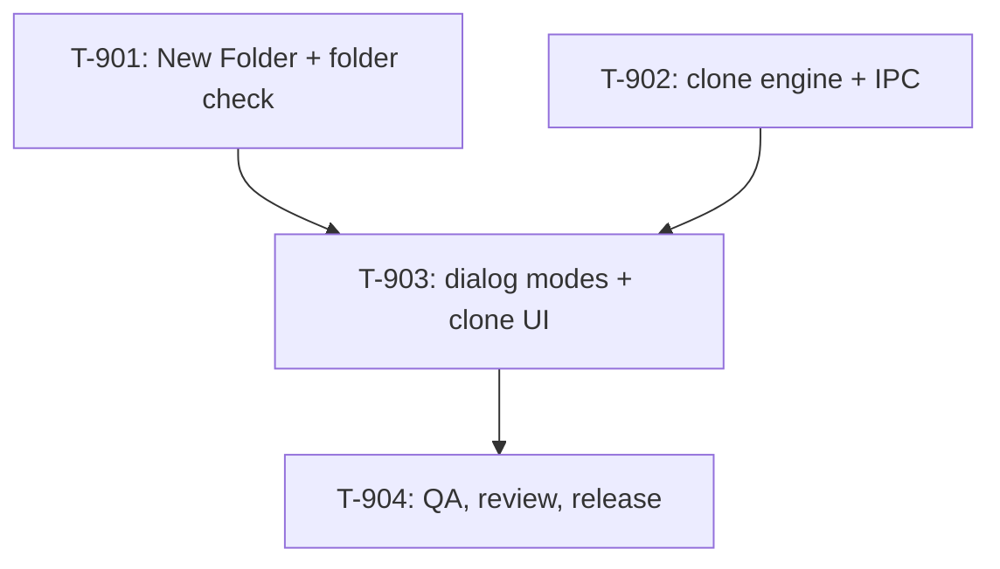

# Kanban: New Project

**Generated:** 2026-11-04
**PRD Version:** 1.0
**Total Tasks:** 4 (T-901..T-904)
**Milestones:** M1 (new folder and clone from the New dialog)

Task ids start at T-901 so they never collide with earlier epics (mobile-v2 reached T-813).

## Task Overview

**Critical path:** T-902 → T-903 → T-904. The dialog's clone mode is a client of the
clone IPC.

**Only looks parallel:** T-901 and T-902 both add to `ipc-handlers.ts`, `preload.ts` and
`shared/types.ts`, and T-903 rewrites the dialog T-901 touches. One lane, in order.

---

## Milestone 1: New folder and clone from the New dialog

**Goal:** PRD Stories 1 to 4.

**Done when:** a folder made in the picker, a typed missing path, a clone that works, one
that fails, one cancelled and one onto an existing folder all behave as the PRD says; type,
lint and tests pass; the builder's test of the installed build passes G-701.

### T-901: The picker's New Folder button, and a check of the typed folder
- **Type:** feature
- **Status:** done
- **Story:** 1, 2
- **Description:** Add `createDirectory` to `select-directory`'s `showOpenDialog` in `main/ipc-handlers.ts`, so the picker has a New Folder button. Add an IPC that takes a typed path, expands a leading `~`, makes it absolute, and says whether it is a folder, a file or missing, returning the resolved path. The New dialog's Create uses it: missing or a file shows "This folder does not exist: <path>. To make a new one, use Browse, then New Folder." and starts nothing; a folder goes on as today, with the resolved path (duplicate check included).
- **Acceptance:** unit tests for the path check (`~`, relative, trailing slash, file, missing); type and lint pass.
- **Blocks:** T-903
- **Blocked by:** none

### T-902: The clone engine and its IPC
- **Type:** feature
- **Status:** done
- **Story:** 3, 4
- **Description:** A main-process module that runs `git clone --progress -- <url> <target>` with the builder's login-shell environment (`backends/opencodeShellEnv.ts`), no shell, stdin closed, its own process group, `GIT_TERMINAL_PROMPT=0` and no terminal to prompt on. It parses git's progress (`\r`-separated stderr lines, percentages), keeps the last lines for the error, and can be cancelled (kill the group). It removes the target after a failure or cancel only if the target did not exist when the clone began. Pure helpers: URL check (https, `ssh://`, `git@host:path`; a GitHub page link becomes its repo URL), repo name from a URL, folder name check. IPC: start (resolves with ok / failed+output / cancelled), cancel, progress events to the renderer, and the default "Clone into" (last cloned-into folder, else the picker's last parent, else the newest contact's parent). One clone at a time.
- **Acceptance:** unit tests for the URL check, the repo name, progress parsing, and the remove-only-what-we-made rule (with a fake git); type and lint pass.
- **Blocks:** T-903
- **Blocked by:** none

### T-903: The dialog's two modes and the clone UI
- **Type:** feature
- **Status:** done
- **Story:** 1, 2, 3, 4
- **Description:** In `renderer/components/NewInstanceDialog.tsx` (styles in `renderer/styles/global.css`): the Open folder / Clone from Git switch (last mode kept in localStorage, like the backend); Clone mode's Git URL, Clone into + Browse, optional Folder name (placeholder the repo's name), the target line, the "already exists" warning with "Open it", the progress box, Cancel clone, the error box with git's lines, the cancelled note; the Alias label's grey hint in both modes. During a clone, every field is off and Esc and outside clicks do nothing. On success, the dialog closes and the session starts in the clone. Follow mock v2 (`.omt/probes/new-project/mock.html`).
- **Acceptance:** each acceptance criterion of Stories 3 and 4 checked in a dev build with a separate `--user-data-dir`; type, lint and tests pass.
- **Blocks:** T-904
- **Blocked by:** T-901, T-902

### T-904: QA, cross-model review and release
- **Type:** qa
- **Status:** done
- **Story:** all
- **Description:** OMT `qa` milestone review against the PRD; one `cross-model-review:gpt-review` (`--model gpt-6.1-sol`); fix what's real. Then the release: patch bump, both READMEs, `pnpm dist`, delete `release/mac-arm64/`. The builder asked for exactly two commits: the terminal-link fix, then this epic with the bump.
- **Acceptance:** QA report in `docs/specs/new-project/qa-report-m1.md`; DMG built.
- **Blocked by:** T-903

## Legend

- **Blocks:** This task must complete before the listed tasks can start
- **Blocked by:** This task cannot start until the listed tasks complete
- **Parallel with:** These tasks have no dependency and can be worked simultaneously

## Changelog
- 2026-11-04: Generated from PRD v1.0.
- 2026-11-04: T-901, T-902, T-903 done (`main/new-project.ts`, `shared/gitUrl.ts`, the dialog). Checked in an isolated dev build over CDP: missing path, `~`, not a URL, a missing repo, an SSH clone that starts its session, the existing-target warning, Cancel during a clone. T-904 started.
- 2026-11-04: QA (`qa-report-m1.md`) found and fixed 4 issues; the cross-model review found 7 more, all fixed. T-904 left: release.
- 2026-11-04: T-904 done: version 0.10.2, both READMEs; the DMG is built from this commit (`pnpm dist`). G-701 and the New Folder button wait for the builder's test of it.
