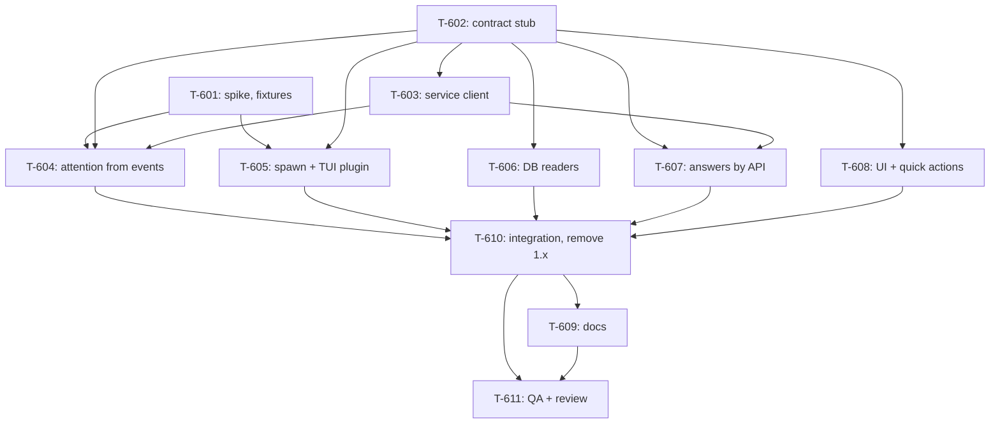

# Kanban: OpenCode 2

**Generated:** 2026-10-20
**PRD Version:** 1.0 (`docs/specs/opencode-v2/prd.md`) · gaps: `docs/specs/opencode-v2/gaps.md`
**Evidence:** `docs/timeline/2026-10-20_opencode-v2-source-reading.md` (every OpenCode fact below; paths in it are inside anomalyco/opencode v2.0.32)
**Total Tasks:** 11 (T-601..T-611)
**Milestones:** M1 (OpenCode 2 at parity), the only one: a half-moved backend is still a broken one

Run in **supervisor mode** (builder, 2026-10-20): epic branch `opencode-v2`, one worktree and
branch per task (`git worktree add ../multi-code-t6NN -b oc2/t-6NN opencode-v2`), merged
`--no-ff` by the supervisor, who alone edits this kanban and `backends/types.ts`. Every call made
without the builder goes into `.omt/opencode-v2-decisions.md`. One cross-model review after
T-610, fixes, then one commit series at the end.

## Task Overview

**Lanes after T-602:** T-601 (spike) · T-603 then T-604 · T-605 (after T-601) · T-606 · T-607 (after T-603) · T-608. T-606 and T-608 need nothing from the spike and start at once.

**Critical path:** T-602 → T-603 → T-604 → T-610 → T-611, with T-601 feeding T-604's fixtures. The spike is the thing to start first.

**File ownership** (a lane edits only its own files; anything else goes back to the supervisor):

| Task | Owns |
|---|---|
| T-601 | `.omt/probes/opencode-v2/*`, `backends/__fixtures__/opencode-v2/*`, `docs/timeline/2026-10-20_opencode-v2-spike.md` |
| T-602 | `backends/types.ts`, stub exports in new files (supervisor) |
| T-603 | `backends/opencodeService.ts` (+ test) |
| T-604 | `backends/opencodeAttention.ts`, `backends/opencodePrompt.ts` (+ tests) |
| T-605 | `backends/opencode.ts` (spawn, version, resume only), `backends/opencodePlugin.ts`, `manager-mcp/config.ts`, `manager-mcp/index.ts` (+ tests) |
| T-606 | `backends/opencodeDb.ts` (+ test, + fixture DB builder) |
| T-607 | `backends/opencodeAnswer.ts`, `secretary/dialog.ts`, `remote/ws-server.ts`, `remote/index.ts`, the answer methods of `process-manager.ts` (+ tests) |
| T-608 | `renderer/**`, `ipc-handlers.ts` (availability only), `preload` bridge, `shared/types.ts` (+ tests) |
| T-610 | the rest of `process-manager.ts`, `backends/opencode.ts` (readers, discovery), deletions |
| T-609 | `CLAUDE.md`, `README*.md`, `docs/knowledge/*` |

Paths are under `workspace/app/src/main/` unless they start with `renderer/`, `shared/`, `docs/` or a dot.

---

## Milestone 1: OpenCode 2 at parity

### T-601: Spike: run OpenCode 2 in isolation and record what it really does
- **Type:** setup
- **Status:** done
- **Story:** 1, 3, 4, 10 (settles G-601..G-605)
- **Description:** Source reading says how OpenCode 2.0.32 should behave; this task measures it, so the attention rules and tests rest on real events. Build a probe under `.omt/probes/opencode-v2/` that runs `~/.opencode/bin/opencode` in a pty (node-pty or Python pty, as `.omt/probes/voice-secretary/t509/` does) with **every** state path isolated: `XDG_DATA_HOME`, `XDG_CONFIG_HOME`, `XDG_STATE_HOME`, `XDG_CACHE_HOME`, `OPENCODE_DB` under `/tmp/oc2-spike/`, and the service on its own port (set it in the scratch config with `opencode service set port <free port>` under the same env) so the builder's real service on 49374 is never touched. Subscribe to the scratch service's `GET /api/event` with the scratch `service.json` credentials and log every frame with a timestamp.
  Measure and record:
  1. G-602: whether OpenCode's free models run turns with no login; if not, stop and report (the supervisor asks the builder).
  2. G-601: a TUI plugin directory named in `OPENCODE_CLI_CONFIG_CONTENT` `plugins` loads; the entry file name it needs; `ui.router.current()` values through start, first prompt with a pre-minted `--session ses_…` id, `/new` + prompt, `/sessions` switch, `/clear`; how it can watch the route (slot + effect, or polling) and post to a local HTTP endpoint; that `{package, options}` entries pass options; that `tabs.mode: "off"` hides tabs and `keybinds["terminal.suspend"]: "none"` makes Ctrl+Z harmless.
  3. G-603: SSE sequences, saved as fixtures (one JSON file per scenario: the frames in order with relative ms): plain finish; API error (e.g. a bad model id); double-Esc interrupt; permission Allow once / Always allow / Reject / Reject from a subagent with a reason; a permission with no `save`; question single-select, multi-select, two questions, dismissed (Esc), answered by API; a subagent that asks a permission; two root sessions in one TUI (`/sessions` while one runs); service replaced mid-turn (start a TUI of the same binary with a different reported version is not possible, so use `opencode service restart` and record what a subscriber sees).
  4. G-604/G-605: what env the scratch service process gets when a TUI started it with `MULTICODE_*` and `OPENCODE_CLI_CONFIG_CONTENT` set (`ps eww <pid>`), what the agent's shell tool sees (`env` run by the agent), and whether `opencode service start` from a clean env avoids it. Recommend one, with the evidence.
  5. A scratch `opencode.db` after these runs, copied into the fixtures folder only if it is small and holds no secrets; otherwise a script that rebuilds it.
- **Acceptance:** `docs/timeline/2026-10-20_opencode-v2-spike.md` answers G-601..G-605 with evidence; fixtures exist in `workspace/app/src/main/backends/__fixtures__/opencode-v2/` with a README listing each scenario; the builder's real service, DB and config are untouched (check `~/.local/state/opencode/service.json` and the real DB's newest `time_updated` before and after).
- **Blocks:** T-604, T-605
- **Blocked by:** none
- **Parallel with:** T-602, T-603, T-606, T-607, T-608
- **Notes:** Never kill a process you didn't start; never run against the real XDG dirs; low volume for any sound. Free model turns cost nothing; anything that would spend on the builder's providers stops and asks.

### T-602: Contract stub for the new OpenCode pieces
- **Type:** setup
- **Status:** done
- **Story:** all
- **Description:** So lanes can start together, the supervisor commits the shared shapes first on `opencode-v2`: in `backends/types.ts`, a `DialogRef` (`{kind: "permission"|"form", sessionId, requestId}`) carried on `PromptToolCall`; a `DialogAnswer` (`{kind:"permission", decision: "once"|"always"|"reject", message?}` | `{kind:"form", answer: Record<string, string|string[]>}`); an optional `HookAttention.answer(ref, answer): Promise<AnswerResult>`; an optional session-shown callback and `liveSessionId()` on the attention; a degraded reason next to `onHooksHealth`. Stub files exporting the signatures of `opencodeService.ts`, `opencodeDb.ts`, `opencodeAnswer.ts` with `throw new Error("not implemented")` bodies, plus the new `AnswerPlan` variant `{answer: DialogAnswer}` in `secretary/dialog.ts`.
- **Acceptance:** `pnpm type` and `pnpm test` pass on the stub; each lane's prompt names the signatures it implements.
- **Blocks:** T-603..T-608
- **Blocked by:** none
- **Parallel with:** T-601

### T-603: OpenCode service client
- **Type:** integration
- **Status:** done
- **Story:** 3, 5, 6, 9, 10
- **Description:** One connection from Multi-Code's main process to the user's shared OpenCode service, in `backends/opencodeService.ts`. It finds the service through `<XDG_STATE_HOME or ~/.local/state>/opencode/service.json` (fields `id, version, url, pid, password`), authenticates with HTTP Basic `opencode:<password>`, and keeps `GET /api/event` (SSE, `data:` frames, heartbeat comment every 15 s) open while at least one OpenCode contact runs. It reconnects with backoff when the stream drops, treats 45 s of silence as a drop, notices a new registration (`id` or `pid` changed) and reconnects to it, and on every `server.connected` tells its listeners to re-sync. It offers the snapshot reads (`GET /api/session/active`, `/api/session/:id`, `/api/session/:id/permission`, `/api/session/:id/form`) and the replies (`POST …/permission/:requestID/reply {decision, message?}`, `POST …/form/:formID/reply {answer}`, `DELETE …/form/:formID`), mapping 404 and 409 to "already handled". Reports connected / unreachable with a reason for Story 9. The password never leaves this module: not logged, not in errors, not in events.
- **Acceptance:** unit tests against a local fake HTTP server cover: discovery with and without `XDG_STATE_HOME`; auth header; frame parsing (multi-line, comments, partial chunks); reconnect after drop; stall detection; registration replaced → reconnect + re-sync signal; 404/409 → "gone"; no request when there is no registration; password absent from every log line and error message.
- **Blocks:** T-604, T-607
- **Blocked by:** T-602
- **Parallel with:** T-601, T-605, T-606, T-608
- **Notes:** Node's built-in `fetch` streams SSE; no new dependency. Only ever talk to the loopback URL in the registration. Never start, stop or restart the service.

### T-604: Attention from service events
- **Type:** feature
- **Status:** done
- **Story:** 3, 4, 9, 11
- **Description:** Rewrite `backends/opencodeAttention.ts` so an OpenCode contact's Finished / Needs-you / cleared come from the service's events (T-603) and its shown session from the TUI plugin's deliveries (T-605's `multicode.route` and `multicode.init` through `/alert`). A contact owns the sessions its terminal has shown since this spawn started, and their subagents (walk `parentID`, learned from `session.created` or `GET /api/session/:id` for an unknown session). Rules (PRD Story 3): `session.execution.started` on an owned root → busy; `succeeded` and `failed` → Finished; `interrupted` with `user` or `shutdown` → nothing; `inactivity` → Finished (⚠️ PRD assumption); `permission.asked` and `form.created` (any owned session, subagents too) → Needs-you with detail; `permission.replied`, `form.replied`, `form.cancelled` → clear that request; any turn end clears every open request of its tree (an interrupted permission sends no reply); on re-sync, rebuild busy roots and open requests from the snapshot and emit only the difference (no second chime for a dialog already reported). Rewrite `backends/opencodePrompt.ts` detail decoding: a permission's options follow `save` (three, or two without "Always allow"), question forms (`metadata.kind: "question"`, fields `q0…`) decode to the same PromptDetail as today, other forms (MCP elicitation) raise Needs-you without options. Each reported prompt carries its `DialogRef`. Plugin health: no `multicode.init` within 10 s → degraded "plugin"; the service client reporting `unreachable` (it already waits 15 s) → degraded "service" at once. The "Always allow" option's description says the pattern is saved for this project from now on (the phone shows it, the secretary's interpreter reads it). Reuse `toPermissionRequest` / `toFormInfo` from `opencodeService.ts`.
- **Acceptance:** `opencodeAttention.test.ts` and `opencodePrompt.test.ts` replay every T-601 fixture and assert the activity sequence; tests for re-sync without duplicate chime, service replaced mid-turn (no event, resumed turn finishes once), subagent dialog, two roots in one contact, events of a session no contact owns ignored, a stopped contact ignoring everything.
- **Blocks:** T-610
- **Blocked by:** T-601, T-602, T-603
- **Parallel with:** T-605, T-606, T-607, T-608
- **Notes:** Pure module apart from the service client it is handed; timers injected as `claudeHooks.ts` does. No polling.

### T-605: Spawn OpenCode 2 with the TUI plugin
- **Type:** feature
- **Status:** done
- **Story:** 1, 2, 4, 8, 10
- **Description:** In `backends/opencode.ts` (spawn path only) and `backends/opencodePlugin.ts`: always pass `--session <id>`: the contact's own id, else the directory's newest root session no other contact holds (via T-606's lookup), else a freshly minted `ses_` id (`ses_` + 12 hex of the bit-inverted `ms*4096+counter` + 14 base62, as `packages/schema/src/identifier.ts`), and return it as `SpawnConfig.sessionId` so discovery never runs. Build `OPENCODE_CLI_CONFIG_CONTENT` = `{"tabs":{"mode":"off"}, "keybinds":{"terminal.suspend":"none"}, "plugins":[…the user's own cli.json plugins, read-only, resolved relative to its directory…, Multi-Code's plugin dir]}`; if the user's `cli.json` can't be read safely, spawn without the plugin (degraded, never a changed config). Drop `OPENCODE_CONFIG_CONTENT` and the V1 plugin entirely. Write the TUI plugin (report-only, plain JS, the entry file name T-601 measured) into `<userData>/opencode/`: on setup it posts `multicode.init`, and on every route change `multicode.route {sessionID|null}`, to `/alert` with the same instance and spawn headers and token file as today; inert without them; FIFO, timeouts and swallowed errors as the V1 plugin. Update `manager-mcp/config.ts` / `index.ts` to write and remove it. Add `opencodeVersion()` (parse `opencode --version`) and make 1.x a refused spawn with a reason the UI can show (Story 2). Strip `CLAUDE_CODE_SSE_PORT` from the env. `buildResumeCommand` → `opencode -s <id>`. Environment (builder decision 2026-10-20, decisions.md "OpenCode gets the builder's login-shell environment"): read the login-shell env once per run (`$SHELL -l -i -c`, from a minimal env, timeout, cached; warmed in the background before it's needed) and use it as the base env of every OpenCode spawn, falling back to today's env when it can't be read. When no live service is registered (`service.json` missing or its pid dead), start it before the TUI with that env minus `MULTICODE_*`, `OPENCODE_CLI_CONFIG_CONTENT`, `CLAUDE_CODE_SSE_PORT`, without blocking the main thread (e.g. the pty runs `/bin/sh -c '<clean env> "$0" service start; exec "$0" "$@"'`). Plugin entry file: `tui.js`; watch the route reactively (`ui.slot` + `createEffect`), per the spike.
- **Acceptance:** `spawnOptions.test.ts`, `opencodePlugin.test.ts` cover: own / latest-unclaimed / fresh ids; minted id format; CLI config content with and without a user `cli.json` (plugins kept, unreadable file → no plugin); plugin source inert without ids; version parse for `opencode v2.0.32`, `1.18.35`, garbage. A live check with T-601's probe shows the plugin's route reports arriving.
- **Blocks:** T-610
- **Blocked by:** T-601, T-602
- **Parallel with:** T-603, T-604, T-606, T-607, T-608
- **Notes:** Never write the user's `cli.json`. Keep `opencode.ts`'s DB readers untouched (T-610 swaps them).

### T-606: Read OpenCode 2's tables
- **Type:** data
- **Status:** done
- **Story:** 1, 4, 7
- **Description:** New `backends/opencodeDb.ts`, read-only on `opencode.db` (`$OPENCODE_DB`, else `<XDG_DATA_HOME or ~/.local/share>/opencode/opencode.db`): `sessionExists(id)`; `latestRootSession(cwd, isClaimed)` (exact `directory`, also its resolved form, `parent_id IS NULL`, newest `time_updated`); `transcript(sessionId, limit)` from `session_message` ordered by `seq` (user text, assistant text, tool entries with one-line summaries for both vocabularies: `shell`/`bash`, `read`/`write`/`edit` with `path` or `filePath`, `patch`/`apply_patch`, `grep`, `glob`, `webfetch`, `websearch`, `subagent`/`task`, `question`, `skill`, `execute`, `shell` rows run by the human; running = `streaming`/`running`; drop reasoning, synthetic, system, skill, compaction and bookkeeping rows); `builderTurn(sessionId)` (typed = `user` rows' `text`; three earlier; everything after the latest typed, as today's `BuilderTurn`); `contextUsage(sessionId, configPath)` (newest `assistant` with `tokens`: input + cache.read + cache.write, model id and provider id; nothing older than a completed `compaction`); `contextWindow(model, provider)` from the config (`providers` V2 key, then `provider` V1 key with the two renames), then the kv `models-dev:catalog` entry, else null. Same error policy as today: unreadable → null/empty, never throws.
- **Acceptance:** `opencodeDb.test.ts` against a fixture DB built by a script in the test (the V2 DDL from the timeline, rows of both vocabularies, a compaction, a subagent, a `/private/tmp` directory); a read-only smoke run against the builder's real DB prints counts only and leaves its mtime unchanged.
- **Blocks:** T-610
- **Blocked by:** T-602
- **Parallel with:** T-601, T-603, T-605, T-607, T-608
- **Notes:** Never select `user.files` (base64 images); use `json_extract`. Tests must not read the real HOME (tech-conventions.md).

### T-607: Answer dialogs through the API
- **Type:** feature
- **Status:** done
- **Story:** 5, 6
- **Description:** Phone and secretary answer OpenCode dialogs with T-603's replies instead of keystrokes. `backends/opencodeAnswer.ts` maps a phone choice (index into the PromptDetail options) to a `DialogAnswer`: permission index → `once`/`always`/`reject` following the options actually offered; single-select question index → `{q0: label}`; anything else refused. The phone's `choose` path (`remote/ws-server.ts`, `remote/index.ts`, `process-manager.ts`) calls the instance's attention `answer(ref, answer)` when the live prompt carries a `DialogRef`, and keeps keystrokes for Claude; "already handled" → the existing "no longer available" error. In `secretary/dialog.ts`, OpenCode dialogs produce an `{answer: DialogAnswer}` plan: permissions with two or three options, reject with a reason (`message`), allow-always still behind the confirmation rule; questions single, multi-select, several questions and typed text (`answer` map, `string[]` for multi-select). `process-manager.answerDialog` applies such a plan once, only while the event's seq is live, and maps "gone" to `answered`. Update the secretary's wording of "always" for OpenCode (saved for this project, not until restart).
- **Acceptance:** tests for every mapping (2- and 3-option permissions, out-of-range index, multi-select refused on the phone, secretary multi-question and typed answers, reject with reason), the stale-seq refusal, Claude's keystroke path unchanged (existing tests pass untouched).
- **Blocks:** T-610
- **Blocked by:** T-602, T-603
- **Parallel with:** T-604, T-605, T-606, T-608
- **Notes:** The phone no longer offers "Type your own answer" for OpenCode questions (it used to be a navigable row).

### T-608: UI and quick actions for OpenCode 2
- **Type:** feature
- **Status:** done
- **Story:** 2, 8, 9, 11
- **Description:** Renderer and IPC only. Rename Session sends `/rename <name>` in one write for OpenCode too. Show Cost stays disabled; its tooltip names `/stats`. The alerts-off bar shows the degraded reason ("can't reach OpenCode's background service" / "Multi-Code's terminal plugin didn't load"), replacing the V1 plugin text. The New Instance dialog distinguishes "not found" from "1.x found: run `curl -fsSL https://opencode.ai/v2/install | bash`" (availability IPC returns a reason). A contact refused for 1.x shows the same reason on its page. The quit confirmation leaves OpenCode contacts out (quitting doesn't cut their turns off).
- **Acceptance:** component or unit tests where they exist today; a CDP check on an isolated dev instance (`--user-data-dir=/tmp/…`) of the dialog text and the bar.
- **Blocks:** T-610
- **Blocked by:** T-602
- **Parallel with:** T-601, T-603..T-607
- **Notes:** Quit-dialog list comes from `processManager.unfinishedInstances()`; change the filter there only if the renderer can't (coordinate with T-610 through the supervisor).

### T-610: Wire it together and remove 1.x
- **Type:** integration
- **Status:** done
- **Story:** all
- **Description:** On `opencode-v2` after T-604..T-608 merge: `backends/opencode.ts` uses `opencodeDb.ts` for every read and drops the V1 readers, `OpencodeSessionDiscovery`, `findSessionCreatedSince`, `keystrokeForChoice` for OpenCode; `process-manager.ts` attaches the session the attention reports as shown (claim-checked), follows `liveSessionId()` instead of DB polling for OpenCode, and keeps Claude's paths byte-for-byte; delete the V1 fixtures, the V1 plugin events, every `question.v2`/`permission.v2` name. The service client starts with the first running OpenCode contact and stops with the last.
- **Acceptance:** `pnpm lint`, `pnpm type`, `pnpm test`, `pnpm build` pass; `grep` finds no V1 table name (`FROM session `, `FROM message`, `FROM part`), no `OPENCODE_CONFIG_CONTENT`, no OpenCode arrow-key mapping; a dev instance on isolated userData starts an OpenCode contact against the T-601 scratch setup and chimes on a finished turn.
- **Carried over:** from T-608: remove the now-unused `isBackendAvailable` / `isOpencodeAvailable`; the 1.x refusal text names the same command as the New Instance dialog (`curl -fsSL https://opencode.ai/v2/install | bash`), from one constant; a start refused through the manager's `start_session` must still reach the renderer (push the instance, e.g. `instance-started`); fix the stale `--continue` comment above `unfinishedInstances`. From T-606: the secretary's builder turn now leaves out OpenCode's injected rows (synthetic, system, skill), unlike 1.x which kept synthetic text as user entries; update or delete `opencodeTurn.test.ts` accordingly. From T-607: the old "an OpenCode instance (PRD v1.6)" case in `process-manager.secretary.test.ts` still uses 1.x labels; `processManager.keystrokeForChoice` is now only Claude's path. From T-604: wire `new OpencodeAttention(onActivity, onHooksHealth, context)` into `opencodeBackend.createHookAttention` and delete the `OpencodePluginAttention` adapter and the 1.x keystroke functions in `opencodePrompt.ts`; share the `multicode.init` / `multicode.route` names with `opencodePlugin.ts`; decide whether a contact may adopt a subagent session the TUI shows; when `onSessionShown` is refused by the claim check, the attention still owns that session (two contacts could alert for one session): decide.
- **Blocks:** T-609, T-611
- **Blocked by:** T-604, T-605, T-606, T-607, T-608

### T-609: Docs for OpenCode 2
- **Type:** setup
- **Status:** done
- **Story:** all
- **Description:** CLAUDE.md "Architecture" (the API-answer exception), "Session monitoring" (service events + TUI plugin, no server plugin), "Data Storage" (the TUI plugin replaces `opencode/multicode-plugin.js`); both READMEs (OpenCode 2 required, how to upgrade, Stop leaves the turn running); `docs/knowledge/tech-conventions.md` (OpenCode state from the service; the V2 tables); `business-overview.md` backend roadmap → "Supported on 2.x".
- **Carried over:** from T-607: the brief writer's prompt is now v11 (only the note on OpenCode's permission names changed); add a "v11" addendum line to `docs/timeline/2026-10-08_brief-writer-spike.md`.
- **Acceptance:** no doc names a removed file or the 1.x plugin; the supervisor's read-through.
- **Blocks:** T-611
- **Blocked by:** T-610

### T-611: QA and cross-model review
- **Type:** qa
- **Status:** done
- **Story:** all
- **Description:** A test plan (`docs/specs/opencode-v2/test-plan.md`) covering every acceptance criterion, run on an isolated dev instance against an isolated OpenCode 2 (T-601's setup) with CDP and the probe, plus one read-only pass on the builder's real data (transcript and context figure of a real session, no turns run). Then `cross-model-review:gpt-review` with `--model gpt-6.1-sol`, one area prompt per lane, fixes, a second round on the fixes. The builder then tries it on real work.
- **Acceptance:** every test-plan row passes or has a recorded reason; review findings fixed or answered in `.omt/opencode-v2-decisions.md`; the epic merges to `master` after the builder's go-ahead.
- **Blocked by:** T-609, T-610

## Legend

- **Blocks:** This task must complete before the listed tasks can start
- **Blocked by:** This task cannot start until the listed tasks complete
- **Parallel with:** These tasks have no dependency and can be worked simultaneously

## Changelog

- 2026-10-20: Generated from PRD v1.0.
- 2026-10-20: T-602 done (contract stub, commit 11389eb). T-601, T-603, T-606, T-608 started in worktrees.
- 2026-10-20: T-607 started early: it needs only the contract's `HookAttention.answer`, not T-603's code. T-604's output shapes for it fixed in `.omt/opencode-v2-decisions.md`.
- 2026-10-20: T-608 done and merged (f4b2b15). Its carry-overs added to T-610.
- 2026-10-20: T-603 done and merged (b6dc635). The 15 s unreachable threshold lives in the client: T-604 shows the bar on `unreachable` with no wait of its own. `toPermissionRequest` / `toFormInfo` are exported for T-604.
- 2026-10-20: T-606 done and merged (457b22b); T-607 done and merged (c9d1b15). Epic branch: type check clean, 1290 tests pass. Carry-overs added to T-610 and T-609; T-604 must reword "Always allow" ("saved for this project").
- 2026-10-20: T-601 done and merged (d8e7773): 24 fixtures, G-601..G-605 answered. Builder chose the login-shell env + Multi-Code starting a missing service (PRD v1.1). T-604 and T-605 started.
- 2026-10-20: T-604 done and merged (a810587): 24 fixtures replayed, 1343 tests pass on the epic branch.
- 2026-10-20: T-611 done. QA run (test-plan.md), B-1 fixed; cross-model review in three stages (seven area reviews, a second round on the fixes, a 3-round review loop ending clean), accepted findings fixed, every changed path re-run live. 1377 tests pass. Merging to `master` waits for the builder's go-ahead.
- 2026-10-20: T-605 done and merged (684a3a7). T-610 done by the supervisor: 1.x readers, discovery, keystrokes, plugin and fixtures removed; `OpencodeAttention` wired; refused 1.x starts keep the contact's session; `Backend.warm()` reads the login shell when OpenCode contacts load; a subagent session the TUI shows is never adopted; one shared upgrade-command constant. Lint, type, 1358 tests, build all pass. T-610's live check moves into T-611.
- 2026-10-20: T-609 done (CLAUDE.md, both READMEs, tech-conventions, business-overview, brief-writer v11 note). T-611 started: live QA in an isolated dev build, then the cross-model review.
- 2026-10-20: The gpt-review skill (apra-amcos-cc-marketplace cross-model-review 1.2.0) speaks OpenCode 1.x's API and fails on 2.x. Builder: record it, ask the marketplace's session to update the skill, and hold the cross-model review until then (write-up `.omt/gpt-review-opencode-v2-issue.md`, sent to the `claude-sdlc` session).
- 2026-10-20: `claude-sdlc` fixed the skill in the marketplace working tree (uncommitted). Builder: run the review once they have committed, pushed and updated the plugin.
