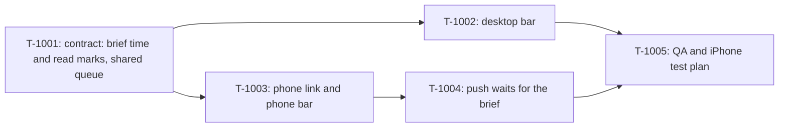

# Kanban: Secretary Bar

**PRD:** `docs/specs/secretary-bar/prd.md` v1.1
**Branch:** `secretary-bar` (from master 0bf2703, after 0.10.7)
**Decisions made without the builder:** `.omt/secretary-bar-decisions.md`

## T-1001: Contract (done, 5744bd0)

- **Requirement:** PRD Stories 2 and 4
- **Code:** `shared/types.ts` (`SecretaryBriefState.at`, `.seen`), `shared/secretaryQueue.ts`,
  `main/secretary/index.ts` (`markSeen`, `onInstanceRead`), `main/process-manager.ts`
  (`onInstanceRead`, `noteRead`, `readOnPhone`), `main/ipc-handlers.ts`
  (`instance-acknowledged`)
- **Acceptance:** unit tests for the queue and the seen mark; full suite green.

## T-1002: Desktop bar

- **Requirement:** PRD Stories 1, 2, 3, 4 and 7, desktop side
- **Code:** new `renderer/components/SecretaryBar.tsx` (+ css), `renderer/App.tsx`,
  `renderer/components/secretaryBrief.ts`, `SecretaryCard.tsx` (goes), `audio/briefPlayer.ts`
- **Description:** One bar across the top of the window while Secretary Mode is on, driven by
  `shared/secretaryQueue.ts`. Title "<session> · Secretary" (click selects the contact), state,
  text (three lines folded, full when open), Play/Replay/Stop, ‹ n / N ›, "Got it" on a
  Finished, exchanges and the reply box on a replyable Needs you. Nothing plays without a
  click. "Got it" and playing to the end read the session (clear its unread, send
  `acknowledgeInstance`). The card over the terminal, the header's Secretary button and the
  red-dot click's card and autoplay go. The terminal refits when the bar's height changes.
- **Acceptance:** unit tests for the bar's view rules; the real app driven over CDP with its
  own `--user-data-dir` shows the bar, plays, moves on, and the terminal stays fully visible.

## T-1003: Phone link and phone bar

- **Requirement:** PRD Stories 1, 2, 3, 4, 5 and 7, phone side
- **Code:** `shared/remote-protocol.ts`, `main/remote/remote-host.ts`, `ws-server.ts`,
  `remote/index.ts`, `renderer-mobile/` (new bar component, `App.tsx`, `ListScreen.tsx`,
  `state.ts`, `transport.ts`), `main/secretary/` (audio for the phone)
- **Description:** The phone learns the mode and every brief, turns the mode on and off,
  marks a Finished brief seen ("Got it", played to the end), sends replies in words, and
  fetches a brief's audio, compressed on the Mac with `afconvert` (at most 1 MB per minute).
  The bar sits at the top of every screen: one line folded, a panel when tapped. The mode
  switch sits on the list header. A phone running an older cached app keeps working.
- **Acceptance:** protocol and host unit tests; the mobile harness (`pnpm harness`,
  `pnpm harness:shot`) shows the bar folded and open on the list and a session.

## T-1004: Push waits for the brief

- **Requirement:** PRD Story 6
- **Code:** `main/remote/remote-host.ts` (`pushEvent`), `main/remote/push.ts`
- **Description:** With the mode on, an event's push waits for its brief's text (ready or
  failed), at most 30 s from the event; the body is the brief's first sentence. Failed or
  late: today's body. Mode off: unchanged.
- **Acceptance:** unit tests with fake timers for ready, failed, late, replaced and mode off.

## T-1005: QA

- **Acceptance:** full suite, lint and types green; a cross-model review per ticket and a
  review loop over the epic; an iPhone test plan for G-801 and G-802 (silent switch, lock);
  a release build the builder installs and tests on the real phone.
