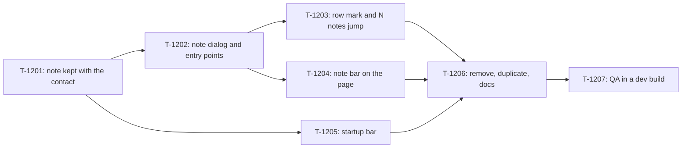

# Kanban: Session Notes

PRD: `docs/specs/session-notes/prd.md` (v1.0). One lane: every task changes the same few
files (`ContactList.tsx`, `App.tsx`, `process-manager.ts`), so they run one after another.

### T-1201: The note is kept with the contact
- **Story:** 1, 2
- **Description:** A contact can hold one note (text, time of the last save). Main keeps it,
  saves it in `contacts.json`, and gives it to the renderer with the contact. Saving empty
  text removes it. More than 2,000 characters is refused. Starting, stopping, restarting
  and a new session inside the contact keep it. It never goes to the phone.
- **Status:** done (2026-11-19, branch `session-notes`, not committed)

### T-1202: Note dialog and its two entry points
- **Story:** 1
- **Description:** "Leave a note…" / "Edit note…" in the row's right-click menu, and a
  Note button in the page header. Both open one dialog with a multi-line box. Enter is a
  new line; Cmd+Enter or Save saves; Esc or Cancel closes. Keys typed in it never reach
  the terminal, and an IME composition is never cut short by Esc or Cmd+Enter.
- **Blocked by:** T-1201
- **Status:** done (2026-11-19, branch `session-notes`, not committed)

### T-1203: Row mark and the "N notes" jump
- **Story:** 3
- **Description:** A note mark on the row, with the start of the note on hover. "1 note" /
  "N notes" at the top of the sidebar; a click opens the next noted session after the
  selected one, in the order the list draws, wrapping.
- **Blocked by:** T-1202
- **Status:** done (2026-11-19, branch `session-notes`, not committed)

### T-1204: The note bar above the terminal
- **Story:** 2
- **Description:** The selected session's note, its time ("Yesterday 18:42"), Edit and
  Got it, above the terminal. Long notes scroll inside the bar. Terminals refit when the
  bar comes, goes or changes height.
- **Blocked by:** T-1202
- **Status:** done (2026-11-19, branch `session-notes`, not committed)

### T-1205: The startup bar
- **Story:** 4
- **Description:** Once per run of the main process, the sessions with notes at that
  moment are listed at the top of the window: name, first line, time. A click opens the
  session; Close hides the bar for the rest of the run. A session drops out of the list
  when its note is cleared; the bar goes when none is left.
- **Blocked by:** T-1201
- **Status:** done (2026-11-19, branch `session-notes`, not committed)

### T-1206: Remove, duplicate, docs
- **Story:** 5
- **Description:** The remove confirmation names the note. Duplicate does not copy it.
  CLAUDE.md "Data Storage" lists the note in `contacts.json`. Both READMEs at release.
- **Blocked by:** T-1203, T-1204, T-1205
- **Status:** done (2026-11-19, branch `session-notes`, not committed)

### T-1207: QA in a dev build
- **Story:** all
- **Description:** In an isolated dev instance (`--user-data-dir=/tmp/...`), driven over
  CDP: each acceptance criterion, light and dark theme, screenshots.
- **Blocked by:** T-1206
- **Status:** done (2026-11-19, branch `session-notes`, not committed)
