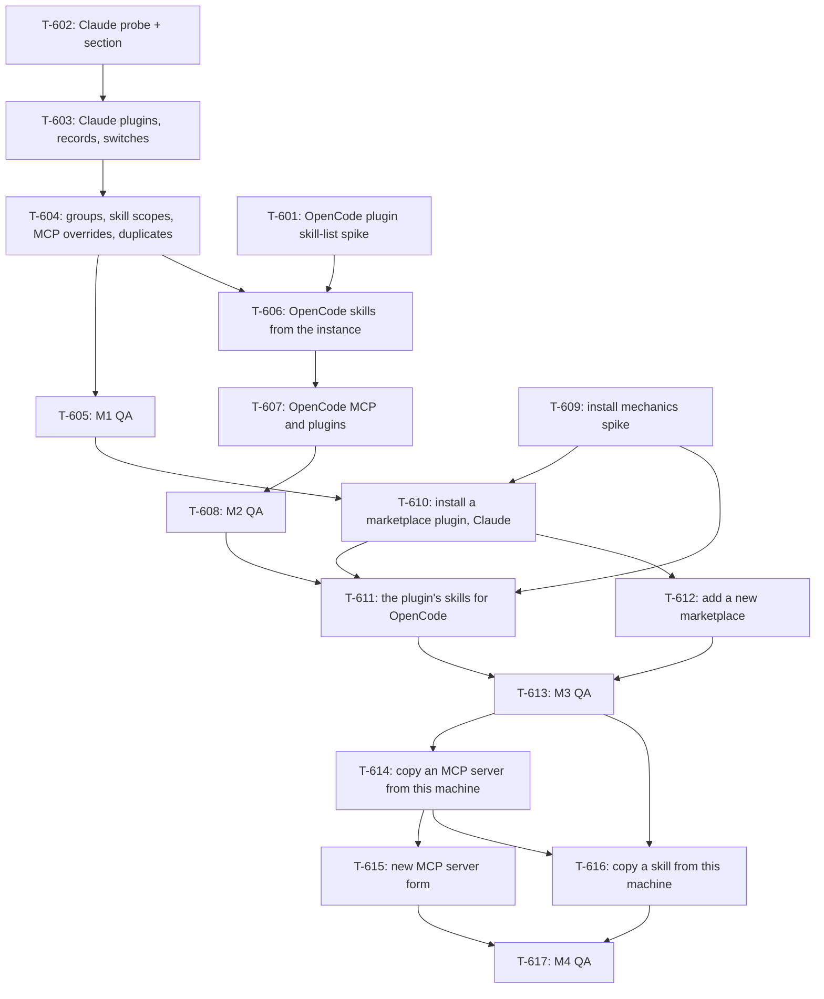

# Kanban: Skills and MCP

**Generated:** 2026-10-13
**Source:** `docs/specs/skills-mcp/prd.md` v1.2 · `docs/specs/skills-mcp/gaps.md` (nothing open)
**Evidence:** `docs/timeline/2026-10-12_skills-mcp-inventory-investigation.md`
**Total Tasks:** 17 (T-601..T-617)
**Milestones:** M1 (see what a Claude Code session loads) · M2 (OpenCode too) · M3 (install a plugin into a project) · M4 (install MCP servers and skills)

Task ids start at T-601, after voice-secretary's T-5xx. Only M1 is committed; M2 to M4 are
re-planned when the milestone before them ships. Work happens on a `skills-mcp` branch,
merged into `master` when a milestone passes QA.

Every task that spawns `claude -p` passes `--no-session-persistence`. A user-level hook
denies Bash calls without it, but Multi-Code's own spawns are not Bash calls, so the code
must pass it itself (PRD Technical Constraints).

## Task Overview

**Order:** T-602 → T-603 → T-604 → T-605, with T-601 and T-609 alongside.

**Critical path:** T-602 → T-603 → T-604 → T-606 → T-607 → T-608 → T-611 → T-613 → T-614 →
T-615 → T-617. Every later view task extends the inventory model and section that T-602
to T-604 build. The OpenCode view decides when the first two-backend install can be
checked, because T-611 verifies OpenCode through T-606's data.

### Parallel lanes

Each round's tasks touch different files and can run in separate sessions at once. A round
starts when everything it is blocked by has merged.

| Round | In parallel | Why they don't collide |
|---|---|---|
| 1 | **T-602**, **T-601**, **T-609** | T-601 and T-609 are spikes. They write only probes under `.omt/probes/skills-mcp/` and a `docs/timeline/` record |
| 2 | T-603 | Extends T-602's module and section |
| 3 | T-604 | Same files as T-603 |
| 4 | **T-605**, **T-606** | T-605 is QA and changes no code |
| 5 | **T-607**, **T-610** | T-607 stays in the OpenCode inventory files. T-610 adds new `skills-mcp/install*.ts` files and `InstallDialog.tsx`; its only touch on `SkillsMcpSection.tsx` is the Install button |
| 6 | **T-608**, **T-612** | T-608 is QA |
| 7 | T-611 | Needs T-608 and T-610 |
| 8 | T-613 | M3 QA |
| 9 | T-614, then T-615 and T-616 | All three add a source to the install picker: sequence them |
| 10 | T-617 | M4 QA |

To run a round in parallel, give each task its own worktree and branch off `skills-mcp`,
e.g. `git worktree add ../multi-code-t601 -b sm/t-601 skills-mcp`.

---

## Milestone 1: See what a Claude Code session loads

**Goal:** the builder opens "Skills and MCP" on a Claude Code instance and sees its MCP
servers, skills and plugins, this project apart from global, with overrides and duplicates
marked.

**Tasks:** T-602, T-603, T-604, T-605

**Done when:**
- In `multi-code`, the section shows `sentry` (`needs-auth`, `user`) under Global, omt 3.5.0 under This project, and seven duplicate pairs between the old project skills and `omt:` skills (digest, guide, kanban, prd, qa, teach, work)
- In `apra-amcos-admin-dolce`, the local-scope ralph-loop and ralph-wiggum plugins show as enabled under This project
- A manager instance shows its `--mcp-config` server under This session, marked "Multi-Code"
- Ten refreshes leave the number of `.jsonl` files in each project's `~/.claude/projects/` folder unchanged, spend no tokens, and raise no chime or red dot
- Nothing refreshes while the section stays open and nobody presses Refresh

---

### T-602: Claude probe and the Skills and MCP section

- **Type:** feature
- **Status:** done
- **Requirement:** `docs/specs/skills-mcp/prd.md#story-1-the-skills-and-mcp-section`, `docs/specs/skills-mcp/prd.md#story-4-a-claude-code-instance`
- **Knowledge:** `docs/specs/skills-mcp/prd.md#technical-constraints` ("How the probe stops the prompt", "No SSO browser", "No alerts from the probe")
- **Code:** new `workspace/app/src/main/skills-mcp/`; `workspace/app/src/main/backends/claude.ts` (`claudeCliCommand`); `workspace/app/src/main/secretary/cli.ts` (spawn, timeout and kill pattern); `workspace/app/src/main/process-manager.ts` (`managerSpawnOptions`); `workspace/app/src/main/ipc-handlers.ts`; `workspace/app/src/main/preload.ts`; `workspace/app/src/shared/types.ts`; `workspace/app/src/renderer/components/Toolbox.tsx`; new `workspace/app/src/renderer/components/SkillsMcpSection.tsx`
- **Description:** The first path through every layer. In main, `skills-mcp/claudeProbe.ts` exports `probeClaude(cwd, mcpConfigPath?)`. It spawns `claudeCliCommand()` in `cwd` with `-p --no-session-persistence --output-format stream-json --verbose --settings <PROBE_SETTINGS> [--mcp-config <path>] probe` and stdin closed. `PROBE_SETTINGS` is `{"awsAuthRefresh":"false","hooks":{"UserPromptSubmit":[{"hooks":[{"type":"command","command":"echo probe >&2; exit 2"}]}]}}`, the hook command measured on 2026-10-13. It reads stdout lines until `{"type":"system","subtype":"init"}`, then the `result` line, with a 30 s timeout and the SIGTERM-then-SIGKILL stop that `secretary/cli.ts` uses. A pure `parseInit(line)` returns `{ mcpServers: { name, status, source }[], plugins: { name, version, source, path }[], skills: string[], version }`. When the `result` line reports any input or output tokens, the refresh fails with "the probe reached the model": this guards against a CLI change that stops honouring the hook. `ProcessManager` gains `probeTargetOf(id): { cwd, backend, mcpConfigPath? }`, where only the manager has an `mcpConfigPath`. IPC: `refresh-skills-mcp` (instance id) starts a refresh and returns at once. A second call for the same instance while one runs joins it. Main pushes `skills-mcp-update` with `{ instanceId, refreshedAt, running, mcp, skills, plugins }`, where each part is `{ items, error? }`. Renderer: a "Skills and MCP" section (id `skills-mcp`) in the Toolbox accordion, after Quick Actions. It has three parts with counts, a Refresh button, "Refreshed <time>", a running state, per-part errors, and the Story 4 note line. It refreshes when it expands and when the instance changes while it is expanded, and never on a timer. In this task items are flat: name, scope label, status or version. An OpenCode instance shows "OpenCode comes in M2".
- **Acceptance:** Unit tests: `parseInit` on a fixture captured from the real 2.1.296 run (`__fixtures__/claude-init-2.1.296.json`); no init line → an error part; a `result` with tokens > 0 → error; a joined refresh spawns once; the args always contain `--no-session-persistence` and never the instance's `--settings`. A live test (skipped in CI) runs the probe in the repo: init parses, 0 tokens, and the `.jsonl` count in `~/.claude/projects/<encoded cwd>/` is unchanged. In the app on a `multi-code` instance: the counts match a hand-run probe (1 MCP, 7 plugins, 40 skills on 2026-10-13), in about 3 s.
- **Blocks:** T-603 · **Blocked by:** none · **Parallel with:** T-601, T-609
- **Notes:** Keep the env from `claudeCliCommand()`. It already strips `MULTICODE_INSTANCE_ID` and `MULTICODE_SPAWN_ID`, which keeps the probe away from `/alert`. Do not pass `--bare`: it skips plugins and would hide what the section exists to show (check this assumption in the live test).
- **Done 2026-10-13:** On branch `skills-mcp`. `workspace/app/src/main/skills-mcp/` holds `claudeProbe.ts` (`probeClaude`, `parseInit`, `reachedModel`), `refresh.ts` (the join logic, Electron-free) and `index.ts`. Two corrections to the description, both measured: `--mcp-config` takes every argument up to the next flag, so it goes before `--settings` (`--mcp-config <file> probe` failed with "MCP config file not found: <cwd>/probe"); and `--bare` dropped every MCP server and 24 of 40 skills and ignored the hook, so no result came. `refresh-skills-mcp` returns the snapshot as it stands rather than nothing, so a joined refresh still shows its running state. `App.tsx` now lets a stopped instance open this one section (PRD Story 1 edge case); every other section stays closed while stopped. The guard counts cache tokens and cost too, and fails closed when the counts are missing. In the app (dev build, isolated userData) on `multi-code`: 1 MCP (`sentry` `user` `connected`), 40 skills, 7 plugins in 4.0 s; the `.jsonl` count stayed 29. Live test: `MULTICODE_LIVE=1 npx vitest run src/main/skills-mcp/claudeProbe.live.test.ts`, 3.5 s. The accordion remembers its open section per instance, so selecting another instance refreshes only when that instance also has this section open. Cross-model review (gpt-6.1-sol, two rounds) found that a project or local `"disableAllHooks": true` skips the probe's hook and sends the prompt to the API (measured, then fixed): the probe's settings now set `disableAllHooks: false` (measured: it overrides both), it passes `--model multicode-probe-no-model` so a skipped hook gets a 400 with 0 tokens (init lists measured identical), and an error result fails the refresh. CLI stderr is masked by `clipReason` before it reaches the section.

### T-603: Claude plugins: install records, enable switches, overrides

- **Type:** feature
- **Status:** done
- **Requirement:** `docs/specs/skills-mcp/prd.md#story-3-overrides-and-duplicates`, `docs/specs/skills-mcp/prd.md#story-4-a-claude-code-instance`
- **Knowledge:** `docs/timeline/2026-10-12_skills-mcp-inventory-investigation.md` ("Override and the enable switch", "Scope of each kind")
- **Code:** `workspace/app/src/main/skills-mcp/` (new `claudePlugins.ts`); `workspace/app/src/renderer/components/SkillsMcpSection.tsx`
- **Description:** The Plugins part shows every install record and why each one loads or not. Run `claude plugin list --json` in the instance's cwd, in parallel with the probe. Keep rows with `scope: "user"`, or with a `projectPath` equal to the cwd (compare real paths). Read the enable switches from the `enabledPlugins` key only, in `~/.claude/settings.json`, `<cwd>/.claude/settings.json` and `<cwd>/.claude/settings.local.json`. Merge with the probe's `plugins`. The record whose version matches the loaded plugin is the winner. Each other record of the same id shows "overridden by <group>'s <version>", and the winner shows "overrides <scope> <version>". A record with no switch that applies shows "installed, not enabled". A switch with no record shows "enabled, not installed". `@builtin`, `@inline` and `@skills-dir` sources have no record and pass through as loaded.
- **Acceptance:** Unit tests from fixtures: the real `multi-code` list output; the `apra-amcos-admin-dolce` state before 2026-10-12 from the investigation table (omt 3.4.1 project and 3.5.0 user, switch in user only, 3.4.1 loaded → 3.5.0 shows overridden by this project's 3.4.1); a record without a switch; a switch without a record. In the app on `apra-amcos-admin-dolce`: ralph-loop and ralph-wiggum show `local` and enabled.
- **Blocks:** T-604 · **Blocked by:** T-602
- **Done 2026-10-13:** `workspace/app/src/main/skills-mcp/claudePlugins.ts` (`readPluginState`, `parsePluginList`, `readEnableSwitches`, `mergePlugins`); runs beside the probe in `refresh.ts`. A failed `plugin list` fails the Plugins part alone. Two cases the description did not cover, both shown rather than guessed: two records of the loaded version (the install path is keyed by version, so it cannot tell them apart) show "which of these records loaded is not stated by Claude Code"; a loaded marketplace plugin with no record here shows "no install record for this project". A record with a switch that is on but not loaded shows "enabled, not loaded". A global winner reads "overridden by global <version>". The row shows where the switch that applies sits, as in "enabled (local)". In the app (dev build, isolated userData): `multi-code` 8 rows, `apra-ai-ba` greyed "installed, not enabled"; `apra-amcos-admin-dolce` ralph-loop and ralph-wiggum `local`, "enabled (local)". After review: a `project` or `local` record without `projectPath` fails the parse; user settings follow `CLAUDE_CONFIG_DIR` (measured: it moves `.claude.json` too), relative to the cwd; a settings file that exists but cannot be read fails the part.

### T-604: Groups, skill scopes, MCP overrides and duplicates

- **Type:** feature
- **Status:** done
- **Requirement:** `docs/specs/skills-mcp/prd.md#story-2-global-and-this-project-apart`, `docs/specs/skills-mcp/prd.md#story-3-overrides-and-duplicates`
- **Knowledge:** `docs/specs/skills-mcp/prd.md#definitions`
- **Code:** `workspace/app/src/main/skills-mcp/`; `workspace/app/src/shared/types.ts`; `workspace/app/src/renderer/components/SkillsMcpSection.tsx`
- **Description:** Every item gets `group: "project" | "global" | "session" | "builtin"` beside its exact scope label, and the section lists the groups in that order with empty ones hidden. Skill scope: a `<plugin>:` prefix takes the plugin's scope from T-603; a folder `<cwd>/.claude/skills/<name>/` means `project`; `~/.claude/skills/<name>/` means `user`; anything else is built-in. When both folders exist for one name, show both copies with "not stated by Claude Code". An unprefixed skill `x` and a plugin skill `p:x` both carry a duplicate mark naming the other. MCP overrides: the probe's `source` names the winner's scope. Find other definitions of the same name by key only, in `~/.claude.json` (`mcpServers` for user, `projects[<cwd>].mcpServers` for local) and `<cwd>/.mcp.json` (project), and show them as overridden. The `--mcp-config` server sits under This session, marked "Multi-Code". Main never puts `env`, `headers` or any config value other than the name and scope into the IPC payload.
- **Acceptance:** Unit tests with temp folders and a fake home: each skill scope; two copies of one name; the duplicate pair; one MCP name at user and local scope with local winning per the probe; a test that the payload object has no `env` or `headers` key at any depth. In the app on `multi-code`: seven duplicate pairs (digest, guide, kanban, prd, qa, teach, work), `sentry` under Global.
- **Blocks:** T-605, T-606 · **Blocked by:** T-603
- **Done 2026-10-13:** `workspace/app/src/main/skills-mcp/claudeScopes.ts` (`readLocalConfig`, `mcpItems`, `skillItems`, `groupOf`, `pluginGroupOf`). Measured in a scratch project on 2.1.296: a `sentry` in `.mcp.json` beat the user `sentry` and the probe said `source: "project"`; a `--plugin-dir` plugin's MCP server, in its `.mcp.json` or its `plugin.json`, did not appear in the init message, so no source format is assumed for one. Added a fifth group, `other`, for what the section cannot place: an unknown `source`, or a plugin skill whose plugin's scope is unknown (Plugins failed, or the plugin is missing from it). A plugin skill whose plugin has two loaded records shows one row per record with "which copy loaded is not stated by Claude Code". A switch with no record sits in its settings file's group. Every `dynamic` server is marked Multi-Code, because the probe's only command-line config is the manager's. MCP overrides read "overrides user" / "overridden by local". Duplicates match on the name after the prefix, so two plugins' `x` are marked too. Counts count what loads, once per name (Plugins is 7 again in `multi-code`, not 8). In the app on `multi-code`: `sentry` under Global, the seven pairs marked, 21 skills under This project, 3 under Global, 16 Built-in. The manager line of M1 is left to T-605. After review: a skill folder counts only with a `SKILL.md`; the resolved cwd is looked up in `~/.claude.json` before the path as given; a config file that exists but cannot be read fails the MCP part. Rejected: showing MCP before `plugin list` answers (Skills and Plugins need both sources; a comment in `refresh.ts` says why).

### T-605: M1 QA pass

- **Type:** qa
- **Status:** backlog
- **Requirement:** `docs/specs/skills-mcp/prd.md#phase-1-see-what-an-agent-loads`
- **Code:** none
- **Description:** Run `qa` against M1's "Done when" on `multi-code`, `apra-amcos-admin-dolce`, `apra-amcos-admin-hrr` and a manager instance. Check each list against a hand-run probe and `claude plugin list --json` in the same cwd. Count `.jsonl` files before and after ten refreshes. Watch for a chime or red dot during refreshes. Write the plan to `docs/specs/skills-mcp/test-plan.md`.
- **Acceptance:** Every M1 "Done when" line passes, or fails with a bug task filed.
- **Blocks:** T-610 · **Blocked by:** T-604 · **Parallel with:** T-606

---

## Milestone 2: OpenCode too

**Goal:** the same section on an OpenCode instance shows what that running instance
loaded, including which copy of a duplicate skill it picked.

**Tasks:** T-601, T-606, T-607, T-608

**Done when:**
- An OpenCode instance in `multi-code` shows its 18 skills; each of the seven duplicates shows the copy this instance loaded, the other copy, and the random-pick note
- After the instance restarts, the section follows the copy the new process picked
- An instance started before the plugin change shows "restart this instance to see its skills"
- MCP shows `documonster` and `sentry` with their status, under Global
- Multi-Code's own plugin sits under This session, marked "Multi-Code"
- The plugin still changes no OpenCode behaviour: the attention-alerts tests pass unchanged

---

### T-601: Spike: can the OpenCode plugin read the instance's skill list?

- **Type:** setup
- **Status:** ready
- **Requirement:** `docs/specs/skills-mcp/prd.md#open-questions` (1)
- **Knowledge:** `docs/knowledge/decisions.md` (2026-10-12, "OpenCode instances report their skills through Multi-Code's plugin")
- **Code:** `workspace/app/src/main/backends/opencodePlugin.ts`, `workspace/app/src/main/backends/opencode.ts` (`OPENCODE_CONFIG_CONTENT`); OpenCode's plugin types at `~/.config/opencode/node_modules/@opencode-ai/plugin/dist/index.d.ts`
- **Description:** The OpenCode route rests on this. Write a throwaway plugin under `.omt/probes/skills-mcp/oc-plugin-skills/`. On init it takes `{ client, serverUrl }`, tries `GET /skill` through `client` and through `fetch(new URL("/skill", serverUrl))`, and writes the result and the timing to a temp file. Load it the way Multi-Code does, through `OPENCODE_CONFIG_CONTENT`, into the OpenCode 1.18.35 TUI in a pty, with no `--port`, in `multi-code`. Answer: (1) which call works; (2) the shape (`name`, `location`, anything else); (3) does it match the copy the instance uses for a duplicate name (run it several times and compare with `opencode debug skill` in the same process if possible); (4) does `GET /mcp` work the same way, so MCP status could come from the instance too.
- **Acceptance:** A record in `docs/timeline/` with the plugin source, the exact launch command, the answers, and sample output. PRD Open Question 1 answered through `prd`. If no call works, the record says so and the route goes back to the builder.
- **Blocks:** T-606 · **Blocked by:** none · **Parallel with:** T-602, T-609
- **Notes:** Remove the probe's records afterwards. Do not fetch on the event hook's path: `opencodePlugin.ts` documents why the hook never awaits the network.

### T-606: OpenCode skills from the running instance

- **Type:** feature
- **Status:** backlog
- **Requirement:** `docs/specs/skills-mcp/prd.md#story-5-an-opencode-instance`, `docs/specs/skills-mcp/prd.md#story-3-overrides-and-duplicates`
- **Knowledge:** T-601's timeline record; `docs/timeline/2026-10-12_skills-mcp-inventory-investigation.md` ("OpenCode")
- **Code:** `workspace/app/src/main/backends/opencodePlugin.ts`, `workspace/app/src/main/backends/opencodeAttention.ts`, `workspace/app/src/main/process-manager.ts` (`handleAlertDelivery`), `workspace/app/src/main/skills-mcp/`, `workspace/app/src/renderer/components/SkillsMcpSection.tsx`
- **Description:** The plugin reports what the instance loaded. After its `multicode.init` post, the plugin reads the skill list the way T-601 settled. It does this without blocking init, and posts `{ hook_event_name: "multicode.skills", skills: [{ name, location }] }` with no skill content and a size cap. Main stores the latest report on the instance (`opencodeSkills?: { at, skills }`). `opencodeAttention.ts` keeps ignoring it. The inventory maps each skill's location to a scope: under the cwd means project; under `~/.config/opencode/` or a `skills.paths` entry from the global config means global; `customize-opencode` is built-in. For copies, it scans the folders OpenCode reads (`.opencode/skills/`, `.claude/skills/`, `~/.config/opencode/skills/`, `~/.claude/skills/`, and `skills.paths` from `opencode debug config` run in the cwd) for other `<name>/SKILL.md`. It shows the loaded copy first, then the others, with the random-pick note. No report means "restart this instance to see its skills".
- **Acceptance:** Unit tests: the generated plugin source posts `multicode.skills` after init and never awaits the network in the event hook; main stores the report and ignores a report from an earlier spawn; the location-to-scope mapping and the copy scan on temp folders. The existing `opencodePlugin` and `opencodeAttention` tests pass unchanged. In the app: M2's first three "Done when" lines.
- **Blocks:** T-607 · **Blocked by:** T-601, T-604 · **Parallel with:** T-605

### T-607: OpenCode MCP servers and plugins

- **Type:** feature
- **Status:** backlog
- **Requirement:** `docs/specs/skills-mcp/prd.md#story-5-an-opencode-instance`
- **Knowledge:** T-601's timeline record ((4) decides the MCP source)
- **Code:** `workspace/app/src/main/skills-mcp/`, `workspace/app/src/main/backends/opencode.ts` (binary path, injected config), `workspace/app/src/renderer/components/SkillsMcpSection.tsx`
- **Description:** MCP comes from `opencode mcp list` run in the cwd on each refresh, or from the instance if T-601 found that `GET /mcp` works there. Each server shows its name and status. Scope: a key in `~/.config/opencode/opencode.json` `mcp` is global; anything else in the resolved config is project. Plugins: each `plugin` entry in the resolved config (`opencode debug config` in the cwd), with its scope, plus Multi-Code's own plugin under This session, marked "Multi-Code" (it is injected at spawn, so a separate process does not see it). No env or header value leaves main.
- **Acceptance:** Unit tests: a parser for the real `opencode mcp list` output (fixture); the scope split on fixture configs; the payload has no `env`, `environment` or `headers` key. In the app: M2's last three "Done when" lines.
- **Blocks:** T-608 · **Blocked by:** T-606 · **Parallel with:** T-610

### T-608: M2 QA pass

- **Type:** qa
- **Status:** backlog
- **Requirement:** `docs/specs/skills-mcp/prd.md#story-5-an-opencode-instance`
- **Code:** none
- **Description:** Run `qa` against M2's "Done when" on an OpenCode instance in `multi-code`. Restart it at least three times to see the duplicate copies change. Add the cases to `docs/specs/skills-mcp/test-plan.md`.
- **Acceptance:** Every M2 "Done when" line passes, or fails with a bug task filed.
- **Blocks:** T-611 · **Blocked by:** T-607 · **Parallel with:** T-612

---

## Milestone 3: Install a plugin into a project

**Goal:** from the section, the builder installs a marketplace plugin into this project
for Claude Code and OpenCode in one dialog, after a preview of every command and file,
and sees it load.

**Tasks:** T-609, T-610, T-611, T-612, T-613

**Done when:**
- In a scratch repository with no `.claude/` folder, installing omt at "shared through git" scope shows a preview whose commands and files match what the install then writes, and nothing else changes in the repository
- Nothing is written before Install, and Cancel writes nothing
- The scope question has no default; Install stays disabled until one is chosen
- After the install, the section shows omt loading in Claude Code, and the restart note names the running instances in that project
- OpenCode gets omt's skills, or is unchecked with the reason, as T-609 settled
- A failing command stops the install and lists the steps already done
- A new marketplace added from its GitHub repository shows its plugins for picking

---

### T-609: Spike: what each install command writes, on both CLIs

- **Type:** setup
- **Status:** ready
- **Requirement:** `docs/specs/skills-mcp/prd.md#story-8-preview-and-checks-before-writing`, `docs/specs/skills-mcp/prd.md#open-questions` (2, 3)
- **Knowledge:** `docs/timeline/2026-10-12_skills-mcp-inventory-investigation.md` ("Traps for an install feature")
- **Code:** none (probes under `.omt/probes/skills-mcp/install/`)
- **Description:** A preview can only show what an install will write if the writes are known. In a scratch git repository (`git init` in a temp folder), on Claude Code 2.1.296 and OpenCode 1.18.35, record the files each command creates or changes, with a diff of each, and `git check-ignore` for each file: (1) `claude plugin install omt@apra-amcos-cc-marketplace --scope project`, then `--scope local`, with `--json` output; (2) `claude plugin marketplace add <repo> --scope project` and `--scope local`; (3) `claude mcp add --scope project` and `--scope local`, and `claude mcp add-json`, with an env value written as `${VAR}`: does it stay literal in the file and expand at load, and what status does a probe report for a project-scope server before approval; (4) OpenCode: does `skills.paths` take a relative path, and relative to what (Open Question 2); is there a private per-project config (Open Question 3); does `{env:VAR}` expand in an `mcp` entry; can `opencode mcp add` run without prompts, and where does it write; (5) is there a private place for a project skill in either CLI; (6) for Open Question 6, which private, per-project file each CLI reads variables from: does `.claude/settings.local.json` `env` reach a server, and what is OpenCode's equivalent; bring the builder the two best options, including Multi-Code reading named variables from `<project>/.env` at spawn. Method and scripts: `docs/timeline/2026-10-13_mcp-env-vars-experiment.md`, `.omt/probes/skills-mcp/env/`.
- **Acceptance:** A record in `docs/timeline/` with each command, its diffs and its ignore status. PRD Open Questions 2 and 3 answered through `prd`; Open Question 6 taken to the builder as two options. The scratch installs are removed afterwards (`claude plugin uninstall --scope project|local` from the scratch folder), and `claude plugin list --json` shows no record for it.
- **Blocks:** T-610, T-611, T-614, T-616 · **Blocked by:** none · **Parallel with:** T-601, T-602

### T-610: Install a marketplace plugin into this project (Claude Code)

- **Type:** feature
- **Status:** backlog
- **Requirement:** `docs/specs/skills-mcp/prd.md#story-6-pick-what-to-install`, `docs/specs/skills-mcp/prd.md#story-7-choose-where-it-goes`, `docs/specs/skills-mcp/prd.md#story-8-preview-and-checks-before-writing`, `docs/specs/skills-mcp/prd.md#story-9-install-and-confirm-it-loads`
- **Knowledge:** `docs/knowledge/decisions.md` (2026-10-12, "Multi-Code writes agent config only when the builder clicks Install"); T-609's timeline record
- **Code:** new `workspace/app/src/main/skills-mcp/installPlan.ts`, `workspace/app/src/main/skills-mcp/installRun.ts`; new `workspace/app/src/renderer/components/InstallDialog.tsx`; `workspace/app/src/main/ipc-handlers.ts`; `workspace/app/src/main/preload.ts`; `workspace/app/src/renderer/components/SkillsMcpSection.tsx` (the Install button only)
- **Description:** The first path through the whole install, with one source and one backend. Picker: "Known marketplaces", from `claude plugin marketplace list --json` and each marketplace's `.claude-plugin/marketplace.json` at its `installLocation`, with name, version and description. Scope: "This project, shared through git" (`project`) or "This project, private to me" (`local`), with no default. Backends: Claude Code checked; OpenCode unchecked with "comes in T-611". `planInstall(request)` in main returns `{ planId, steps: { backend, argv, files: { path, shared, addedLines }[] }[], warnings, blockers }`, built from T-609's measured writes. `shared` comes from `git check-ignore` and whether the path is inside the repository. Checks: "already installed" when the same id and version already load; an override note for another version; record and switch both applying to this project, or a blocker. `runInstall(planId)` runs exactly that plan's steps, in order, through `claudeCliCommand()`, and refuses an unknown or already-run `planId`. It streams each command's output, stops at the first failure, and returns the steps done. Then it refreshes the section, marks each installed item as loading or not, and names the running instances whose cwd is this project as needing a restart.
- **Acceptance:** Unit tests: plans for `project` and `local` scope match T-609's diffs; `shared` marks; already-installed; a blocker when the switch would not apply; `runInstall` refuses an unknown or reused `planId`, runs only the planned argv, and stops on failure. In the app, in a scratch repository: M3's first four "Done when" lines.
- **Blocks:** T-611, T-612 · **Blocked by:** T-605, T-609 · **Parallel with:** T-607

### T-611: The plugin's skills for OpenCode, in the same install

- **Type:** feature
- **Status:** backlog
- **Requirement:** `docs/specs/skills-mcp/prd.md#story-7-choose-where-it-goes`, `docs/specs/skills-mcp/prd.md#story-8-preview-and-checks-before-writing`
- **Knowledge:** T-609's timeline record (Open Questions 2 and 3)
- **Code:** `workspace/app/src/main/skills-mcp/installPlan.ts`, `workspace/app/src/main/skills-mcp/installRun.ts`, `workspace/app/src/renderer/components/InstallDialog.tsx`
- **Description:** Add OpenCode steps to a plugin plan, so OpenCode in this project loads the plugin's skills, in the way T-609 found works at the chosen scope. The preview says OpenCode takes only the plugin's skills. When the scope cannot be honoured for OpenCode (an absolute path would land in a shared file, or there is no private project config), OpenCode is unchecked with the reason. The duplicate check covers OpenCode skill names from T-606's data and warns that OpenCode would pick one copy at random. After the run, OpenCode is checked by the files being in place and by `opencode debug skill` in the cwd listing the names. The running instance only reports them after a restart, and the note says so.
- **Acceptance:** Unit tests for the OpenCode steps at each scope, the unchecked-with-reason case, and the random-pick warning. In the app: M3's fifth "Done when" line.
- **Blocks:** T-613 · **Blocked by:** T-608, T-609, T-610

### T-612: Add a new marketplace

- **Type:** feature
- **Status:** backlog
- **Requirement:** `docs/specs/skills-mcp/prd.md#story-6-pick-what-to-install`
- **Knowledge:** T-609's timeline record ((2))
- **Code:** `workspace/app/src/main/skills-mcp/installPlan.ts`, `workspace/app/src/renderer/components/InstallDialog.tsx`
- **Description:** A "New marketplace" source takes a GitHub `owner/repo`, a URL or a path. Its plan is one Claude step, `claude plugin marketplace add <source> --scope <scope>`, with the files T-609 measured. OpenCode is unchecked: marketplaces are Claude-only. After the run, the picker lists the new marketplace's plugins, and a plugin install continues as in T-610.
- **Acceptance:** Unit tests for the plan at both scopes and for input checks (an empty source, a malformed `owner/repo`). In the app: M3's last "Done when" line.
- **Blocks:** T-613 · **Blocked by:** T-610 · **Parallel with:** T-608

### T-613: M3 QA pass

- **Type:** qa
- **Status:** backlog
- **Requirement:** `docs/specs/skills-mcp/prd.md#phase-2-install-into-a-project`
- **Code:** none
- **Description:** Run `qa` against M3's "Done when" in a scratch repository with both backends running. Diff the repository and the user's config files before and after each install, and compare with the preview. Add the cases to `docs/specs/skills-mcp/test-plan.md`.
- **Acceptance:** Every M3 "Done when" line passes, or fails with a bug task filed.
- **Blocks:** T-614, T-616 · **Blocked by:** T-611, T-612

---

## Milestone 4: Install MCP servers and skills

**Goal:** the builder copies an MCP server or a skill from another project or from global
into this project for both backends, or adds a new MCP server. Multi-Code writes no
secret anywhere, and reminds the builder where to set each one.

**Tasks:** T-614, T-615, T-616, T-617

**Done when:**
- An MCP server set at Claude's `user` scope installs into this project for both backends, in each backend's own format
- No env or header value appears in any file the install writes; the preview names each variable the builder must set
- After the install, each variable that is not set shows a reminder with the server, the variable, the absolute path of the file, the line to add and the instance to restart, until the builder sets it
- A server that logs in (`needs-auth`) shows a reminder to log in through `/mcp`
- A Claude MCP server at `project` scope: the preview says Claude asks for approval on first use
- A skill folder from another project installs into this project, with the duplicate check and the "no official command" note
- The new-server form takes variable and header names only, and ends in the same reminders

---

### T-614: Copy an MCP server from this machine, for both backends

- **Type:** feature
- **Status:** backlog
- **Requirement:** `docs/specs/skills-mcp/prd.md#story-6-pick-what-to-install`, `docs/specs/skills-mcp/prd.md#story-8-preview-and-checks-before-writing`
- **Knowledge:** T-609's timeline record ((3), (4))
- **Code:** `workspace/app/src/main/skills-mcp/` (new `machineSources.ts`), `workspace/app/src/main/store.ts` (`loadContacts`), `workspace/app/src/main/skills-mcp/installPlan.ts`, `workspace/app/src/renderer/components/InstallDialog.tsx`
- **Description:** A "This machine" source lists MCP servers from Claude's user scope (`~/.claude.json` `mcpServers`), from each project in Multi-Code's instance list (`projects[<cwd>].mcpServers` in `~/.claude.json`, `<cwd>/.mcp.json`), and from OpenCode's global and project configs. Each shows its name and where it comes from. Config values stay in main, and the renderer sees names only. The plan converts between the two formats: Claude `{ command, args, env }` or `{ type: "http", url, headers }`, and OpenCode `{ type: "local", command: [...], environment }` or `{ type: "remote", url, headers }`. It uses the commands T-609 found that run without prompts. Every env and header value becomes a reference (`${NAME}` for Claude, `{env:NAME}` for OpenCode), at either scope; Multi-Code writes no value (PRD Story 8). The preview lists the variables the builder will set. After the run, the Story 9 reminder shows for each variable that is not set in the file the builder chose for Open Question 6, with the absolute path, the line, copy buttons and the instance to restart. It checks the variable itself, never the server's status. A `needs-auth` server gets the `/mcp` login reminder instead. The preview says a Claude `project`-scope server waits for approval on first use.
- **Acceptance:** Unit tests: both conversions for stdio and http servers; no value in any written file at either scope; the renderer payload has no value; a reminder for an unset variable even when the server reports `connected`; the approval note. In the app: M4's first five "Done when" lines.
- **Blocks:** T-615, T-616 · **Blocked by:** T-609, T-613

### T-615: New MCP server form

- **Type:** feature
- **Status:** backlog
- **Requirement:** `docs/specs/skills-mcp/prd.md#story-6-pick-what-to-install`, `docs/specs/skills-mcp/prd.md#story-9-install-and-confirm-it-loads`
- **Knowledge:** `docs/specs/skills-mcp/gaps.md` (G-001, resolved)
- **Code:** `workspace/app/src/renderer/components/InstallDialog.tsx`, `workspace/app/src/main/skills-mcp/installPlan.ts`
- **Description:** A "New MCP server" form: name, transport (`stdio`, `http`, `sse`), command and arguments or URL, and the names of its environment variables and headers. It has no value fields (G-001). It feeds the same plan and the same reminders as T-614. Input checks: a name already used in this project, an empty command or URL, a variable name that is not a valid identifier.
- **Acceptance:** Unit tests for the form's plan, the input checks, and that the form sends no value field. In the app: M4's last "Done when" line.
- **Blocks:** T-617 · **Blocked by:** T-614

### T-616: Copy a skill from this machine

- **Type:** feature
- **Status:** backlog
- **Requirement:** `docs/specs/skills-mcp/prd.md#story-6-pick-what-to-install`, `docs/specs/skills-mcp/prd.md#story-8-preview-and-checks-before-writing`
- **Knowledge:** `docs/specs/skills-mcp/prd.md#technical-constraints` ("OpenCode also reads `.claude/skills/`"); T-609's timeline record ((5))
- **Code:** `workspace/app/src/main/skills-mcp/machineSources.ts`, `workspace/app/src/main/skills-mcp/installPlan.ts`, `workspace/app/src/renderer/components/InstallDialog.tsx`
- **Description:** The "This machine" source also lists skill folders from other projects' `.claude/skills/`, `~/.claude/skills/` and `~/.config/opencode/skills/`. At shared scope, the plan copies the folder to `<cwd>/.claude/skills/<name>/`, which both backends read. At private scope it uses T-609's answer to (5), or says there is none. No CLI command exists, so the preview says the copy follows the vendor's documented folder layout. The duplicate check covers a plugin skill `p:<name>` in Claude and a same-name skill in OpenCode.
- **Acceptance:** Unit tests: the copy plan, the "no official command" note, and the duplicate warnings. In the app: M4's fourth "Done when" line.
- **Blocks:** T-617 · **Blocked by:** T-609, T-613, T-614

### T-617: M4 QA pass

- **Type:** qa
- **Status:** backlog
- **Requirement:** `docs/specs/skills-mcp/prd.md#phase-2-install-into-a-project`
- **Code:** none
- **Description:** Run `qa` against M4's "Done when" in a scratch repository with both backends. Grep every file the install wrote for each secret value used in the test.
- **Acceptance:** Every M4 "Done when" line passes, or fails with a bug task filed.
- **Blocked by:** T-615, T-616
